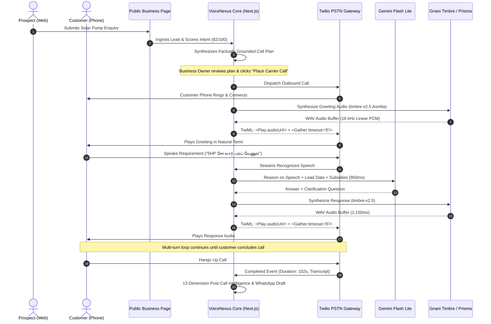

# VoiceNexus AI

> **Autonomous Indic Voice Intelligence & Lead Qualification Platform**  
> *Built for the Gnani AI Great Indian AI Internship Challenge*

[](https://www.typescriptlang.org/)
[](https://nextjs.org/)
[](https://fastify.dev/)
[](https://supabase.com/)
[](https://api.vachana.ai)
[](https://www.twilio.com/)

**Live Application (Render Backend & App)**: [https://gnaniai404.onrender.com](https://gnaniai404.onrender.com)  
**Live Frontend (Vercel Proxy)**: [https://gnaniai404.vercel.app](https://gnaniai404.vercel.app)  
**Sample Public Business Portal**: [https://gnaniai404.onrender.com/p/kaveri-solar-construction](https://gnaniai404.onrender.com/p/kaveri-solar-construction)  
**Executive Solution Pitch**: [docs/SOLUTION_PITCH.md](docs/SOLUTION_PITCH.md)

---

## Overview

**VoiceNexus AI** is an enterprise multi-tenant voice intelligence platform that connects digital enquiries to natural, conversational telephone calls in regional Indian languages. 

When a prospective customer submits an inquiry on a business landing page, VoiceNexus AI analyzes their intent, scores their qualification potential, synthesizes a factually grounded call plan, and enables business owners to initiate carrier-grade outbound calls powered by conversational Indic voice AI.

---

## The Problem Being Solved

In the Indian business ecosystem, over 70% of inbound digital leads go cold within an hour because sales teams cannot place immediate follow-up calls. When manual calls do occur, agents face severe regional language barriers, inconsistent qualification standards, and tedious CRM data entry. 

Conventional automated robocalls fail because rigid pre-recorded audio or unnatural robotic English text-to-speech triggers immediate customer hang-ups. VoiceNexus AI solves this by delivering real-time, multi-turn phone conversations in regional Indian languages (Tamil, Hindi, Telugu, Kannada, Malayalam, and Indian English) using verified Gnani AI speech models.

---

## Key Implemented Features

- **Public Business Portal & Lead Capture**: Responsive showcase page (`/p/[slug]`) with solar ROI calculators, product catalog, social links, and real-time lead capture.
- **Intelligent Intent & Lead Scoring**: Automatic qualification scoring (0–100) based on buyer requirements, property type, budget, and timeline.
- **AI Call Plan Synthesis**: Generates customized opening greetings, conversation objectives, and discovery questions tailored to the prospect.
- **Carrier PSTN Telephony**: Decoupled sequential TwiML architecture supporting natural, continuous multi-turn conversations over cellular networks via Twilio Voice.
- **Native Indic Voice Synthesis**: Real-time text-to-speech using **Gnani Timbre v2.5 and v3.0** with 14 verified regional voice personas.
- **Multilingual Speech Recognition**: Speech-to-text powered by **Gnani Prisma v3.0** with automatic language identification (`indic-auto`).
- **Factual Grounding & Compliance**: Strictly prevents hallucinations by grounding responses in verified product pricing, warranties, and national subsidy schemes (PM Surya Ghar Muft Bijli Yojana).
- **Instant Safety Intercepts**: Automated Do-Not-Call (DNC) opt-out and supervisor escalation protocols.
- **Post-Call Intelligence Engine**: 13-dimension call analysis, automatic call disposition, sentiment tracking, and transcript archiving.
- **Business Automations**: Generates owner-approved follow-up tasks and draft WhatsApp notifications.
- **Multi-Tenant Security**: 26 Supabase PostgreSQL tables isolated by organization using PostgreSQL Row Level Security (RLS).

---

## How VoiceNexus AI Works



---

## Verified Gnani AI Integration

VoiceNexus AI integrates verified Gnani AI models from the official Vachana platform (`api.vachana.ai`):

### 1. Gnani Timbre TTS (Text-to-Speech)
- **Streaming WebSocket**: `wss://api.vachana.ai/api/v1/tts`
- **REST Inference**: `https://api.vachana.ai/api/v1/tts/inference`
- **Models**:
  - `timbre-v2.5`: Low-latency regional speech synthesis (750ms–1400ms turnaround) used for active phone turns.
  - `timbre-v3.0`: Flagship multilingual Indic model with natural code-mixing.
- **Voice Personas**:
  - **Tamil**: `Asmita` (default warm conversational), `Kaveri` (professional), `Suresh` (engineering).
  - **Hindi**: `Ananya` (conversational), `Deepak` (support/sales).
  - **Telugu**: `Chitra` (support), `Girish` (commercial).
  - **Kannada**: `Vidya` (Bangalore/Karnataka advisory).
  - **Malayalam**: `Reshma` (customer care).
  - **Indian English**: `Priya` (corporate), `Rohit` (technical sales).
  - **Multilingual Indic**: `Shivani` (flagship code-mixing), `Avinash` (executive).

### 2. Gnani Prisma STT (Speech-to-Text)
- **Streaming WebSocket**: `wss://api.vachana.ai/stt/v3/stream`
- **REST Endpoint**: `https://api.vachana.ai/stt/v3`
- **Models**: `prisma-v3.0` (with `indic-auto` language detection) and `prisma-v2.5`.
- **Capabilities**: Real-time partial transcription, 16 kHz Linear PCM streaming, and caller barge-in detection.

---

## Technology Stack

- **Frontend Tier**: Next.js 16 (App Router), React 19, Tailwind CSS, Lucide Icons, installable PWA shell.
- **Backend Application Tier**: Next.js Server Actions, Route Handlers, in-memory audio streaming cache.
- **Persistent Voice Gateway**: Fastify WebSocket server (Node.js 24) on port 8081 for real-time browser audio streaming.
- **Database & Identity**: Supabase PostgreSQL (26 tables), Row Level Security (RLS), SSR cookie authentication.
- **Telephony**: Twilio Voice PSTN (outbound call dispatch, sequential TwiML event loops, status tracking).
- **Speech AI**: Gnani AI Timbre TTS & Prisma STT.
- **Conversational Intelligence**: Google Gemini Flash Lite (`gemini-flash-lite-latest`) with Groq LPU failover (`openai/gpt-oss-20b`).

---

## Quick Start & Local Setup

### 1. Clone & Install
```bash
git clone https://github.com/JayaSurya404/gnani-ai.git
cd gnani-ai
npm install
```

### 2. Configure Environment
Copy `.env.example` to `.env.local` and provide your credentials:
```bash
cp .env.example .env.local
```

### 3. Run Development Server
```bash
# Run Next.js Web Application
npm run dev

# Or run both Web Application and Persistent Voice Gateway concurrently:
npm run dev:all
```
Open [http://localhost:3000](http://localhost:3000) to view the application.

### 4. Run Quality Gates
```bash
npm run typecheck    # TypeScript checks (0 errors)
npm run lint         # ESLint analysis (0 warnings)
npm test             # 190 automated unit & integration tests
npm run build        # Next.js production build (31 routes compiled)
```

For complete local setup, database migrations, and telephony tunnel instructions, see [docs/SETUP.md](docs/SETUP.md).

---

## Environment Variables Reference

Configure these variables in your server environment (values must remain private):

| Variable Name | Purpose |
| :--- | :--- |
| `NEXT_PUBLIC_APP_URL` | Application base URL |
| `NEXT_PUBLIC_SUPABASE_URL` | Supabase project URL |
| `NEXT_PUBLIC_SUPABASE_ANON_KEY` | Supabase public anonymous API key |
| `SUPABASE_SERVICE_ROLE_KEY` | Supabase server-only administrative key |
| `VOICE_GATEWAY_SECRET` | Internal authentication token for voice gateway |
| `GNANI_API_KEY_ID` / `GNANI_API_KEY` | Gnani AI Vachana platform API credentials |
| `GNANI_TIMBRE_WS_URL` | Gnani Timbre TTS WebSocket endpoint |
| `GNANI_PRISMA_WS_URL` | Gnani Prisma STT WebSocket endpoint |
| `GEMINI_API_KEY` | Google Gemini API key |
| `GROQ_API_KEY` | Groq LPU API key |
| `TWILIO_ACCOUNT_SID` | Twilio Account SID |
| `TWILIO_AUTH_TOKEN` | Twilio Auth Token |
| `TWILIO_VOICE_NUMBER` | Twilio assigned voice telephone number |
| `TWILIO_WEBHOOK_BASE_URL` | Public webhook URL for Twilio callbacks (ngrok / Render) |
| `DEV_COMPANY_EMAIL` | Demonstration account email (`admin@kaverisolar.in`) |
| `DEV_COMPANY_PASSWORD` | Demonstration account password |
| `OWNER_CREDENTIAL_FILL_ENABLED`| Enables single-click demonstration login autofill |

---

## Project Structure

```text
gnani-ai/
├── docs/                             # Core technical documentation
│   ├── SOLUTION_PITCH.md             # One-page executive project presentation
│   ├── ARCHITECTURE.md               # Detailed system architecture & Mermaid diagrams
│   ├── SETUP.md                      # Complete local installation & deployment runbook
│   └── TECHNICAL_DOCUMENTATION.md    # API reference, Gnani specs & scoring algorithms
├── services/
│   └── voice-gateway/                # Persistent Fastify WebSocket voice gateway
│       ├── src/providers/            # Gnani Prisma STT & Timbre TTS streaming clients
│       └── src/audio-codecs.ts       # G.711 μ-law and Linear PCM16 transcoding
├── src/
│   ├── actions/                      # Next.js Server Actions (Auth, Organization)
│   ├── app/                          # Next.js App Router (31 pages & API route handlers)
│   │   ├── (auth)/                   # Login, Registration, and Password flows
│   │   ├── (workspace)/              # Protected CRM, Calls, Agents, and Settings pages
│   │   ├── api/telephony/            # Outbound calls, TwiML loops, audio streaming
│   │   └── p/[slug]/                 # Public-facing business showcase portal
│   ├── components/                   # Reusable UI component hierarchy
│   ├── lib/
│   │   ├── telephony/                # Gnani TTS/STT clients, audio cache, LLM voice turn
│   │   ├── voice-profiles.ts         # Authoritative Gnani Timbre voice catalog
│   │   └── prompt-templates.ts       # Factual business grounding & anti-hallucination prompts
│   └── types/                        # TypeScript domain contracts and database types
├── supabase/
│   └── migrations/                   # SQL migrations for 26 tables & RLS policies
└── tests/                            # 190 automated unit & integration tests
```

---

## Important Safety & Compliance Safeguards

- **Do-Not-Call (DNC) Intercept**: Real-time keyword preemption automatically suppresses future outbound dialing and terminates calls respectfully when callers opt out.
- **TRAI Calling Hours Window**: Outbound calling requests outside 09:00 to 21:00 IST are rejected with HTTP 422 to comply with telecom regulations.
- **Sample Contact Safeguard**: Automated carrier outbound calls for sample leads are strictly restricted to verified owner destination `+916382868845` to prevent inadvertent spam.
- **Tenant Data Isolation**: Database rows are protected by Supabase Row Level Security (RLS), preventing cross-organization data leakage.

---

## Further Documentation

- [Executive Solution Pitch](docs/SOLUTION_PITCH.md) — One-page submission summary for challenge evaluators.
- [System Architecture](docs/ARCHITECTURE.md) — Comprehensive architectural diagrams and runtime specifications.
- [Installation & Setup](docs/SETUP.md) — Step-by-step local setup and deployment instructions.
- [Technical Documentation](docs/TECHNICAL_DOCUMENTATION.md) — Detailed API contracts, Gnani model parameters, and lead scoring algorithms.
