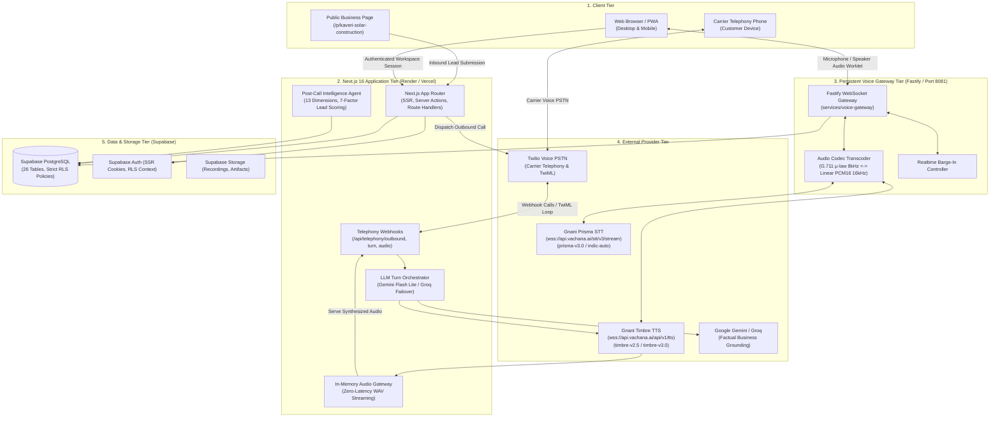
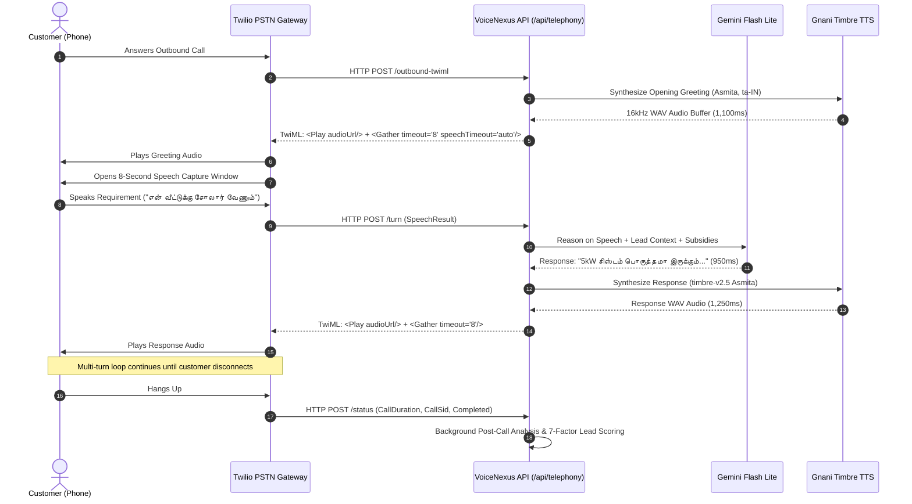
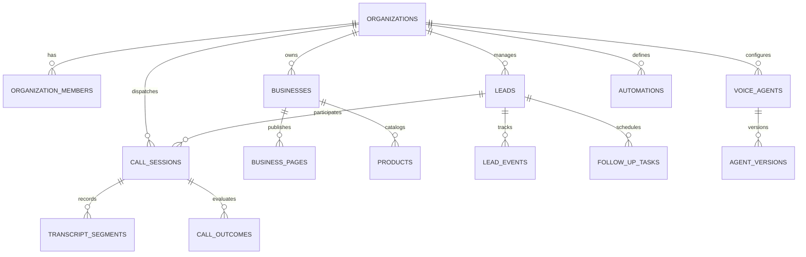

# VoiceNexus AI — System Architecture Specification

## 1. System Vision & Architectural Overview

VoiceNexus AI is an enterprise multi-tenant voice intelligence platform that bridges digital lead capture and natural telephone conversations in regional Indian languages. It combines Next.js 16 full-stack capabilities with dedicated real-time speech gateways, carrier-grade telephony, and verified Gnani AI models.

---

## 2. Runtime Separation of Concerns

### A. Next.js 16 Application Runtime
- **Role**: Primary application server hosting user interface, authentication, business catalog, lead management, and telephony webhook handlers.
- **Outbound Dispatcher (`/api/telephony/outbound`)**:
  - Validates organization context, lead ID, language, and selected voice persona.
  - Verifies Do-Not-Call (DNC) registry and destination phone allowlist.
  - Initiates carrier PSTN calls via Twilio REST API pointing to `/api/telephony/outbound-twiml`.
- **Telephony Turn Handler (`/api/telephony/turn`)**:
  - Receives recognized speech from Twilio `<Gather>`.
  - Dispatches contextual prompt to Google Gemini (`gemini-flash-lite-latest`) within a 2.2-second budget.
  - Requests low-latency audio synthesis from Gnani Timbre TTS (`timbre-v2.5` *Asmita* / regional voice).
  - Caches audio in-memory and returns sequential TwiML `<Play>` followed by `<Gather>`.
- **Post-Call Background Agent**:
  - Automatically triggered upon Twilio `completed` webhook event.
  - Evaluates call transcript across 13 analytical dimensions.
  - Computes explainable 7-factor lead score (0–100) and drafts owner-approved WhatsApp notifications.

### B. Persistent Fastify Voice Gateway (`services/voice-gateway`)
- **Role**: High-concurrency Node.js 24 Fastify daemon running on port 8081 for real-time bidirectional browser voice conversations.
- **Audio Codec Transcoding**: Converts browser 16-bit Float32 PCM (16 kHz) and Twilio G.711 μ-law (8 kHz) without quality degradation.
- **Streaming Speech-to-Text**: Maintains persistent WebSocket to Gnani Prisma STT (`wss://api.vachana.ai/stt/v3/stream`) supporting real-time partial transcripts and instant caller barge-in.
- **Streaming Speech Synthesis**: Streams syntheses from Gnani Timbre TTS (`wss://api.vachana.ai/api/v1/tts`) directly to the client audio sink.

---

## 3. The Carrier Telephony Conversational Turn Loop

VoiceNexus AI employs a sequential TwiML conversational loop to guarantee reliable multi-turn conversations on carrier networks:

---

## 4. Multi-Tenant Database & Security Model

VoiceNexus AI enforces strict organization-level tenant isolation across 26 Supabase PostgreSQL tables:

### Security & Row Level Security (RLS) Guarantees
- Every database row carries an `organization_id` foreign key.
- Supabase Row Level Security (RLS) policies restrict all `SELECT`, `INSERT`, `UPDATE`, and `DELETE` queries to authenticated users holding active membership in that organization.
- Privileged operations (carrier call dispatch, webhook signature validation, credential autofill) execute exclusively in server-only route handlers using the Supabase Service Role key.
