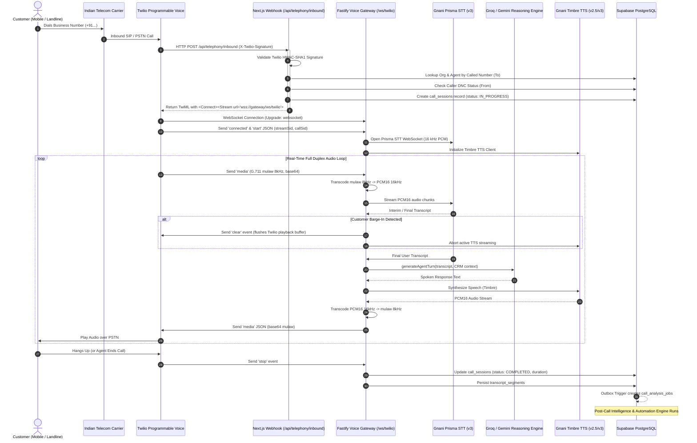
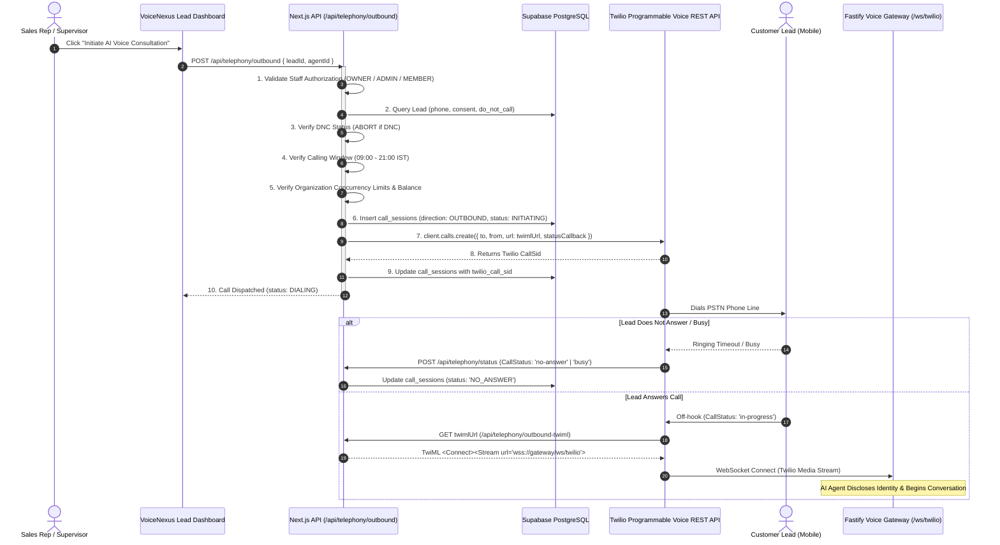
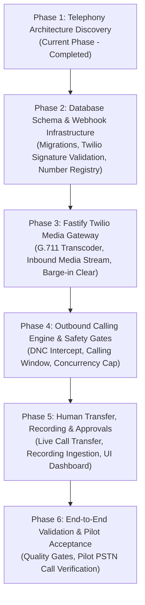

# VoiceNexus AI — Milestone 8 Architecture & Implementation Plan
## Twilio Telephony & Production Hardening

**Milestone:** Milestone 8 — Twilio Telephony & Production Hardening  
**Phase:** Phase 1 — Telephony Architecture Discovery  
**Status:** 📋 Architecture & Discovery Specification (Pre-Implementation)  
**Target Runtime:** Next.js 16 App Router, Fastify Voice Gateway, Supabase PostgreSQL, Gnani Prisma STT v3, Gnani Timbre TTS, Groq LPU / Google Gemini LLM, Twilio Programmable Voice & Media Streams  

---

## Executive Summary

Milestone 8 bridges VoiceNexus AI from a high-performance browser-based voice application to a production-grade enterprise cloud telephony platform. It enables businesses to receive inbound customer phone calls and initiate compliant, consent-verified outbound calls over the Public Switched Telephone Network (PSTN) while preserving the verified voice intelligence, factual grounding, 7-factor explainable lead scoring, durable transactional outbox, and business automation rules established in Milestones 1 through 7.

This architecture plan synthesizes:
1. **Existing Voice Architecture Reuse**: Complete re-use of the battle-tested Gnani STT/TTS adapters, multi-provider LLM reasoning loop (`generateAgentTurn`), factual grounding prompt engine, DNC enforcement, supervisor escalation protocol, and post-call intelligence pipeline without duplicating business logic or creating second-tier agents.
2. **Twilio Media Streams & Bi-Directional Audio Protocol**: Real-time full-duplex audio bridging over WebSockets using G.711 $\mu$-law (8 kHz, 8-bit mono) with instant barge-in buffer clearance (`clear` events) and low-latency audio transcoding.
3. **Strict Indian Regulatory Compliance (TRAI / DoT)**: Comprehensive compliance design adhering to TRAI Telecom Commercial Communications Customer Preference Regulations (TCCCPR), Distributed Ledger Technology (DLT) entity registration, 140-series promotional calling mandates, 160-series transactional calling mandates, NCPR/DND scrubbing, calling-hour constraints (09:00 to 21:00 IST), and CLI spoofing prohibition.
4. **Resilient Inbound & Outbound Calling Lifecycle**: Organization-specific number routing, immediate pre-call DNC verification, atomic concurrency controls, call cost tracking, dual-channel recording with mandatory consent disclosure, and live call transfer to human representatives.
5. **Production Deployment Separation**: Clear delineation between serverless web interfaces (Next.js on Vercel) and long-lived persistent WebSocket audio gateways (Fastify on dedicated containerized compute such as Railway, Fly.io, or AWS ECS).

> [!IMPORTANT]
> **Architecture & Discovery Only**: In strict compliance with Milestone 8 Phase 1 rules, no application source files or database schemas have been modified, no phone numbers provisioned, and no telephone calls initiated. Implementation begins only upon formal acceptance of this specification.

---

## 1. Existing Voice Architecture Audit & Component Reusability

### 1.1 Existing Architecture Inspection
The VoiceNexus voice runtime consists of two primary tiers:
- **Web Application (`src/`)**: Next.js 16 App Router providing workspace navigation, Lead CRM, AI Agent Studio, Call Intelligence Center, Follow-Up Workspaces, WhatsApp Draft Approvals, and Executive Analytics.
- **Voice Gateway (`services/voice-gateway/`)**: A dedicated Fastify server running `@fastify/websocket` on port 3001, providing long-lived WebSocket sessions for real-time speech processing.

```
┌────────────────────────────────────────────────────────────────────────────────────────┐
│                              EXISTING VOICE GATEWAY                                    │
├────────────────────────────────────────────────────────────────────────────────────────┤
│ 1. services/voice-gateway/src/index.ts                                                 │
│    - Fastify HTTP & WebSocket server                                                   │
│    - Routes: /health, /api/diagnostic, /ws/browser                                     │
│                                                                                        │
│ 2. services/voice-gateway/src/gateway-session.ts (BrowserVoiceSession)                 │
│    - Session Lifecycle: init -> audio chunks -> transcript -> agent turn -> TTS -> end │
│    - STT Adapter: PrismaStreamingClient (Gnani Prisma STT WebSocket, 16 kHz PCM16)     │
│    - TTS Adapter: TimbreStreamingClient (Gnani Timbre TTS streaming API)               │
│    - LLM Turn Generation: generateAgentTurn() with prompt grounding & CRM context       │
│    - Instant Interruption: triggerBargeIn() aborts Timbre and notifies client          │
│    - Safety Safeguards: checkExistingDnc(), persistDncOptOut(), persistEscalation()    │
│    - Data Persistence: inserts call_sessions and transcript_segments directly          │
│                                                                                        │
│ 3. Post-Call Intelligence Pipeline (Triggered upon call_sessions COMPLETED)            │
│    - PostgreSQL Transactional Outbox Trigger -> public.call_analysis_jobs              │
│    - Background Analysis Worker: atomic claim, quote verification, lead scoring        │
│    - Business Automation Orchestrator: callback scheduling, tasks, WhatsApp drafts     │
└────────────────────────────────────────────────────────────────────────────────────────┘
```

### 1.2 Component Reusability & Adaptation Matrix

| Voice Component | Existing Implementation | Reusability in Telephony | Adaptation Required for Milestone 8 |
| :--- | :--- | :---: | :--- |
| **STT Engine** | `PrismaStreamingClient` (Gnani Prisma v3) | **100% Reused** | Needs 8 kHz to 16 kHz upsampling adapter OR 8 kHz configuration for Gnani Prisma. |
| **TTS Engine** | `TimbreStreamingClient` (Gnani Timbre v2.5/v3) | **100% Reused** | Needs PCM16 $\to$ G.711 $\mu$-law 8 kHz transcoder and 20ms chunking. |
| **LLM Reasoning** | `generateAgentTurn()` (`llm-provider.ts`) | **100% Reused** | Fully reused. Groq LPU (232ms) and Gemini 2.5 with factual grounding. |
| **Factual Grounding** | `buildGroundedSystemPrompt()` | **100% Reused** | Fully reused. Prevents parametric hallucination and injects CRM lead context. |
| **DNC Enforcement** | `checkExistingDnc()`, `persistDncOptOut()` | **100% Reused** | Enhanced with E.164 normalization and pre-call outbound gateway intercept. |
| **Human Escalation** | `persistSupervisorEscalation()` | **Adapted** | Extended from follow-up task creation to live PSTN transfer via Twilio REST API. |
| **Session Transport** | `BrowserVoiceSession` (`/ws/browser`) | **Parallel Module** | Introduce `TwilioVoiceSession` (`/ws/twilio`) implementing Twilio Media Streams JSON protocol. |
| **Transcript Storage** | `public.transcript_segments` | **100% Reused** | Fully reused. Stores speaker (`CALLER` / `AGENT`), text, offsets, and confidence. |
| **Outbox & Worker** | `call_analysis_jobs` & worker | **100% Reused** | Fully reused. Automatically picks up completed telephony calls for intelligence. |
| **Automation Engine** | `AutomationOrchestrator` | **100% Reused** | Fully reused. Executes callback scheduling, task creation, and WhatsApp drafts. |

---

## 2. Official Twilio Capabilities Assessment

### 2.1 Supported Capabilities
1. **Twilio Programmable Voice**: Full REST API for initiating outbound calls (`POST /2010-04-01/Accounts/{AccountSid}/Calls.json`) and TwiML webhook execution for inbound calls.
2. **Twilio Media Streams (`<Connect><Stream>`)**: Real-time bi-directional raw audio streaming over WebSockets between Twilio's media servers and our persistent Voice Gateway.
3. **G.711 $\mu$-law Format**: Industry-standard telephony codec (`audio/x-mulaw`), 8,000 Hz sample rate, 8-bit mono, packed as raw bytes (no container/WAV header), transmitted as base64-encoded strings inside JSON messages.
4. **Instant Buffer Clearance (`clear` Event)**: Webhook client can send `{"event": "clear", "streamSid": "..."}` to immediately flush Twilio's audio playback queue upon detecting customer barge-in.
5. **Call Status Callbacks**: Asynchronous HTTP webhooks reporting granular call progress: `initiated`, `ringing`, `answered`, `completed`, `busy`, `no-answer`, `failed`, `canceled`.
6. **Dual-Channel Call Recording**: Native recording via `<Dial record="record-from-answer">` or REST API `client.calls(callSid).recordings.create({ recordingChannels: 'dual' })`, separating customer and bot channels.
7. **Live Call Transfer via REST API**: Updating an active call's TwiML execution URL via `POST /Calls/{CallSid}.json` with `Url` to divert the call from `<Connect><Stream>` to `<Dial>` (supervisor number, SIP endpoint, or conference room).
8. **Cryptographic Webhook Signature Verification**: Twilio signs all incoming webhooks with the `X-Twilio-Signature` header (HMAC-SHA1 of full public URL and sorted POST parameters).

### 2.2 Account-Dependent & Region-Dependent Constraints
1. **Account Tier**: Twilio Trial accounts restrict outbound calls to verified caller IDs only and inject an automated trial message before every call. Production requires an upgraded account with funded balance.
2. **Indian Phone Number Provisioning Restrictions**:
   - Local geographic numbers (+91 local area codes) in India are subject to strict Department of Telecommunications (DoT) regulations and require an approved **Twilio Regulatory Bundle** (business registration certificate, local address proof, authorized signatory KYC).
   - Indian National Toll-Free numbers (`000 800` or `+91 800`) are strictly **inbound-only** and cannot be used for outbound CLI.
   - Twilio does not natively issue standard Indian 10-digit mobile numbers for voice.
3. **Outbound CLI Spoofing Prohibition**: The Department of Telecommunications (DoT) and TRAI strictly prohibit transmitting unverified or spoofed Caller ID on calls terminating in India. Outbound calls must display a verified, legally owned E.164 number.
4. **Billing Increments**: Twilio bills voice calls in 60-second increments (rounded up to the next full minute). Media Streams are billed concurrently at $0.0044 per minute.

---

## 3. Indian Telecommunication Regulatory & Compliance Findings

### 3.1 Regulatory Framework Overview
Commercial voice calling in India is governed by:
1. **Telecom Regulatory Authority of India (TRAI)** under the **Telecom Commercial Communications Customer Preference Regulations, 2018 (TCCCPR)**.
2. **Department of Telecommunications (DoT)** licensing and interconnection regulations.
3. **National Customer Preference Register (NCPR / DND)** managed under the Distributed Ledger Technology (DLT) blockchain architecture.

### 3.2 Key Compliance Requirements for VoiceNexus AI

```
┌────────────────────────────────────────────────────────────────────────────────────────┐
│                        INDIAN TELECOM REGULATORY MATRIX (TRAI / DoT)                   │
├──────────────────────────┬─────────────────────────────────────────────────────────────┤
│ 1. Number Series Mandate │ - Promotional Calls: MUST originate from 140-series prefixes │
│                          │ - Transactional/Service: MUST originate from 160-series      │
│                          │ - 10-digit mobile SIM numbers for telemarketing are ILLEGAL │
├──────────────────────────┼─────────────────────────────────────────────────────────────┤
│ 2. DLT Entity & Consent  │ - Enterprise must register as Principal Entity (PE) on DLT   │
│                          │ - Digital consent must be logged with timestamp and scope   │
│                          │ - Unsolicited Commercial Communication (UCC) fines: ₹10,000+│
├──────────────────────────┼─────────────────────────────────────────────────────────────┤
│ 3. Calling Window Hours  │ - Promotional calling allowed ONLY between 09:00 - 21:00 IST│
│                          │ - Outbound promotional calls outside this window are BANNED │
├──────────────────────────┼─────────────────────────────────────────────────────────────┤
│ 4. AI Identity & Consent │ - Mandatory AI self-disclosure at the beginning of the call │
│                          │ - Immediate compliance with customer opt-out / DNC request   │
│                          │ - Mandatory call recording disclosure announcement          │
└──────────────────────────┴─────────────────────────────────────────────────────────────┘
```

### 3.3 VoiceNexus Inbound & Outbound Strategy for India
- **Inbound Support Calls**: Unrestricted by 140/160 series; customers calling in voluntarily can be received on enterprise Toll-Free (`+91 800`), virtual DID, or international access numbers.
- **Outbound Consultation / Callback Calls**:
  - **Direct Customer-Requested Callbacks**: When a customer explicitly requests a callback via the web consultation form or inbound voice session, the call is legally classified as **Service / Transactional (Requested Callback)**.
  - **Cold Commercial Outreach**: Strictly prohibited on standard numbers. Must be routed through registered 140-series DLT routes. In VoiceNexus, **autonomous cold dialing is prohibited**; outbound calling is restricted to consent-verified leads and requested callbacks.
  - **Calling Time Window Guardrail**: System-level hard lock prevents outbound call dispatch outside `09:00 to 21:00 IST` (03:30 to 15:30 UTC).

---

## 4. Inbound Telephony Architecture

### 4.1 Inbound Call Flow Sequence



### 4.2 Inbound Routing & Organization Resolution
When Twilio hits `/api/telephony/inbound`:
1. **Called Number Lookup**: The destination number (`To`) is queried against `public.telephony_phone_numbers` to identify the owning `organization_id` and assigned `agent_id`.
2. **Caller ID Lookup**: The originating number (`From`) is queried against `public.leads` to associate existing CRM context (lead name, prior interactions, notes).
3. **Inbound DNC Preemption**: If the caller is registered as `do_not_call: true`, the call is not dropped; instead, the AI agent is instructed to avoid marketing pitches, acknowledge their privacy preference, and assist with informational or support inquiries only.
4. **TwiML Generation**: Returns a dynamic TwiML response embedding metadata parameters into the `<Stream>` tag:
```xml
<?xml version="1.0" encoding="UTF-8"?>
<Response>
  <Say voice="Polly.Aditi" language="en-IN">Connecting to VoiceNexus AI.</Say>
  <Connect>
    <Stream url="wss://voice.voicenexus.ai/ws/twilio">
      <Parameter name="callSessionId" value="44444444-4444-4444-8444-444444444444" />
      <Parameter name="organizationId" value="11111111-1111-4111-8111-111111111111" />
      <Parameter name="agentId" value="solar-consultant-v1" />
    </Stream>
  </Connect>
</Response>
```

---

## 5. Outbound Telephony Architecture

### 5.1 Outbound Call Flow Sequence



### 5.2 Outbound Safety Invariants & Guardrails
1. **Zero Autonomous Bulk Dialing**: Calls can only be initiated through explicit human user action in the dashboard or via a verified business automation rule triggered by explicit lead opt-in.
2. **Immediate Pre-Call DNC Check**: Even if a lead was qualified hours ago, the API performs a fresh SQL query against `public.leads WHERE (id = :leadId OR phone IN (:variants)) AND do_not_call = true` within the same transaction before calling Twilio.
3. **Calling Hour Enforcement**: Outbound calling requests generated outside 09:00 to 21:00 IST are rejected with HTTP 422: `Outbound calling restricted outside TRAI permitted window (09:00 - 21:00 IST)`.
4. **Rate Limiting & Concurrency**: Maximum 2 concurrent outbound calls per organization (scalable per tier) to prevent unintentional denial-of-service or carrier spam flagging.
5. **Idempotent Dispatch**: Uses deterministic idempotency keys (`call:outbound:{leadId}:{date}`) to prevent duplicate clicks by representatives.

---

## 6. Real-Time Audio Streaming Architecture

### 6.1 Audio Codec & Protocol Transcoding Pipeline

Twilio Media Streams and Gnani Speech engines operate on different native audio formats. The Voice Gateway serves as the low-latency transcoding bridge:

```
[Twilio Phone Call]
       │  (8,000 Hz, 8-bit G.711 μ-law, 20ms frames = 160 bytes)
       ▼
[Twilio WebSocket Client]
       │  JSON: { event: "media", media: { payload: "<base64>" } }
       ▼
┌────────────────────────────────────────────────────────────────────────┐
│                      VOICE GATEWAY TRANSCODER                          │
├────────────────────────────────────────────────────────────────────────┤
│ Inbound Transcode (Twilio -> Gnani Prisma STT):                        │
│ 1. Base64 Decode -> 160 bytes μ-law (PCMU)                             │
│ 2. μ-law expansion table -> 320 bytes PCM16 (8,000 Hz)                 │
│ 3. Linear Interpolation / Resample -> 640 bytes PCM16 (16,000 Hz)      │
│ 4. Stream to Gnani Prisma STT WebSocket                                │
├────────────────────────────────────────────────────────────────────────┤
│ Outbound Transcode (Gnani Timbre TTS -> Twilio):                       │
│ 1. Gnani Timbre outputs PCM16 16,000 Hz audio chunks                   │
│ 2. Downsample (Decimate 2:1) -> PCM16 8,000 Hz                         │
│ 3. 16-bit linear PCM -> 8-bit μ-law compression table                  │
│ 4. Frame into 20ms chunks (160 bytes μ-law)                            │
│ 5. Base64 Encode -> JSON { event: "media", streamSid, payload }        │
│ 6. Send over WebSocket to Twilio                                       │
└────────────────────────────────────────────────────────────────────────┘
```

### 6.2 Low-Latency Transcoder Implementation Strategy
- **Lookup Tables (LUTs)**: G.711 $\mu$-law expansion (8-bit $\to$ 16-bit) and compression (16-bit $\to$ 8-bit) use pre-computed 256-byte and 65,536-byte memory buffers, executing in $\mathcal{O}(1)$ time ($<0.01$ms per frame).
- **Fast Resampling**: Clean 2:1 decimation and linear interpolation for 8 kHz $\leftrightarrow$ 16 kHz sample rate conversions without heavy external C-binding dependencies.
- **Frame Pacing**: Outbound audio frames sent to Twilio must be paced at 20ms intervals (50 packets per second) or streamed continuously in chunks of 160 to 320 bytes to prevent buffer underrun or audio clipping.

### 6.3 Barge-In & Interruption Handling
1. Gnani Prisma STT emits `onSpeechStart` upon detecting customer vocal energy.
2. The Voice Gateway immediately triggers `triggerBargeIn()`:
   - Aborts active Gnani Timbre TTS HTTP streaming request.
   - Emits a `clear` control event over the Twilio WebSocket:
     ```json
     {
       "event": "clear",
       "streamSid": "MZ1234567890abcdef"
     }
     ```
   - Twilio immediately flushes its internal line playback buffer, cutting off the AI voice mid-word on the customer's phone without latency.
   - Sets `isSpeaking = false` and transitions agent state to `listening`.

---

## 7. Human Escalation & Live Call Transfer Architecture

### 7.1 Seven-Stage Escalation Lifecycle

```
[1. Escalation Requested]
       │  (Caller requests human: "transfer me to your manager")
       ▼
[2. Follow-Up Task Created] ──► public.follow_up_tasks (priority: HIGH, status: PENDING)
       │
       ▼
[3. Supervisor Notified]    ──► Internal notification dispatch (Console / Email / Webhook)
       │
       ▼
[4. Representative Available?]
       ├─► NO  ──► Spoken apology: "Our supervisors are assisting other callers; I have logged an urgent callback."
       │           (Call ends gracefully; task remains PENDING)
       │
       └─► YES ──► Proceed to live transfer
                   │
                   ▼
[5. Transfer Initiated]    ──► Twilio REST API update: Calls(callSid).update({ url: transferTwiML })
                   │
                   ▼
[6. Live Transfer Completed] ──► Twilio bridges call to supervisor via <Dial>; call_sessions updated
                   │
                   ▼ (If supervisor does not answer within 25 seconds)
[7. Transfer Failed]       ──► Fallback TwiML apology; follow-up task preserved for callback
```

### 7.2 Transfer Mechanisms: Conference vs. REST Redirect

| Mechanism | Description | Pros | Cons | Recommendation |
| :--- | :--- | :--- | :--- | :---: |
| **REST Redirect (`<Dial>`)** | REST API updates active `CallSid` to fetch new TwiML with `<Dial>` to supervisor phone. | Lightweight, drops WebSocket cleanly, directly rings supervisor PSTN phone. | Cold/blind transfer; caller hears ringing while supervisor is connecting. | **Recommended for VoiceNexus v1** |
| **Conference Room (`<Conference>`)** | Customer and AI start inside a conference room; supervisor is dialed in as a participant. | Supports warm transfer, supervisor whisper, and zero-drop audio. | Higher audio latency (~50-100ms), requires ongoing conference room state management. | Recommended for Milestone 9 Enterprise Contact Center |

### 7.3 Transfer Implementation Detail (REST Redirect)
```typescript
// services/voice-gateway/src/telephony/transfer-service.ts
export async function executeLiveTransfer(params: {
  twilioClient: TwilioClient;
  callSid: string;
  supervisorPhone: string;
  transferTwiMLUrl: string;
}): Promise<{ success: boolean; error?: string }> {
  try {
    await params.twilioClient.calls(params.callSid).update({
      url: `${params.transferTwiMLUrl}?target=${encodeURIComponent(params.supervisorPhone)}`,
      method: "POST"
    });
    return { success: true };
  } catch (err) {
    return { success: false, error: String(err) };
  }
}
```

The transfer endpoint returns TwiML with `<Dial action="/api/telephony/transfer-complete">`:
```xml
<?xml version="1.0" encoding="UTF-8"?>
<Response>
  <Say voice="Polly.Aditi" language="en-IN">Please hold while I connect you to our supervisor.</Say>
  <Dial timeout="25" action="/api/telephony/transfer-complete">
    <Number>+919840123456</Number>
  </Dial>
</Response>
```

---

## 8. Call Recording, Privacy & Data Sovereignty

### 8.1 Consent & Regulatory Disclosure
In compliance with Indian telecommunication norms and data protection guidelines:
1. **Mandatory Audio Disclosure**: Every recorded call plays an opening announcement:
   - English: *"This call is recorded for quality, training, and verification purposes."*
   - Tamil: *"இந்த அழைப்பு தரம் மற்றும் பயிற்சி நோக்கங்களுக்காக பதிவு செய்யப்படுகிறது."*
2. **Opt-Out Handling**: If a caller objects to recording, the call recording must be stopped via Twilio REST API (`client.calls(callSid).recordings('Twilio.CURRENT').update({ status: 'stopped' })`).

### 8.2 Storage Architecture & Signed URLs
Twilio charges $0.0005 per minute per month for recording storage. To ensure data privacy, compliance, and cost efficiency:
1. **Recording Webhook**: Twilio notifies `/api/telephony/recording-callback` upon recording availability.
2. **Private Ingestion**: Backend downloads the audio file from Twilio using HTTP Basic Auth (Twilio credentials).
3. **Supabase Storage Upload**: Audio is stored in a private Supabase Storage bucket (`call-recordings`) under the path:
   `organizations/{orgId}/calls/{callSessionId}.mp3`.
4. **Twilio Deletion**: Once uploaded to Supabase, the recording on Twilio is immediately deleted (`client.recordings(recordingSid).remove()`).
5. **Access Control**: Public access is strictly disabled. Frontend views request short-lived (60-minute) signed URLs generated on-demand by the server with organization-level RLS verification.

---

## 9. Database Proposals (Pre-Implementation Schema Design)

> [!NOTE]
> In strict accordance with Milestone 8 Phase 1 discovery rules, **no SQL migrations have been executed**. The schema below represents the proposed extensions for Phase 2 implementation.

### 9.1 Extension to `public.call_sessions`
Extend `call_sessions` to track telephony-specific metadata:

```sql
-- PROPOSED SCHEMA EXTENSION (Phase 2):
ALTER TABLE public.call_sessions 
  ADD COLUMN IF NOT EXISTS twilio_call_sid TEXT UNIQUE,
  ADD COLUMN IF NOT EXISTS parent_call_sid TEXT,
  ADD COLUMN IF NOT EXISTS telephony_provider TEXT DEFAULT 'BROWSER_WEBRTC'
    CHECK (telephony_provider IN ('BROWSER_WEBRTC', 'TWILIO', 'EXOTEL', 'PLIVO')),
  ADD COLUMN IF NOT EXISTS caller_number TEXT,
  ADD COLUMN IF NOT EXISTS callee_number TEXT,
  ADD COLUMN IF NOT EXISTS recording_sid TEXT,
  ADD COLUMN IF NOT EXISTS recording_url TEXT,
  ADD COLUMN IF NOT EXISTS recording_duration_seconds INT,
  ADD COLUMN IF NOT EXISTS transfer_status TEXT DEFAULT 'NONE'
    CHECK (transfer_status IN ('NONE', 'REQUESTED', 'INITIATED', 'COMPLETED', 'FAILED')),
  ADD COLUMN IF NOT EXISTS transfer_target TEXT,
  ADD COLUMN IF NOT EXISTS telephony_cost NUMERIC(6, 4) DEFAULT 0.0000,
  ADD COLUMN IF NOT EXISTS telephony_currency TEXT DEFAULT 'USD';

CREATE INDEX IF NOT EXISTS idx_call_sessions_twilio_sid ON public.call_sessions(twilio_call_sid);
```

### 9.2 Proposed Table: `public.telephony_phone_numbers`
Maps rented phone numbers to organizations and configured AI agents:

```sql
CREATE TABLE IF NOT EXISTS public.telephony_phone_numbers (
  id UUID PRIMARY KEY DEFAULT gen_random_uuid(),
  organization_id UUID NOT NULL REFERENCES public.organizations(id) ON DELETE CASCADE,
  phone_number TEXT NOT NULL UNIQUE, -- E.164 formatted (e.g. +918001234567)
  provider TEXT NOT NULL DEFAULT 'TWILIO' CHECK (provider IN ('TWILIO', 'EXOTEL', 'TATA_TELE')),
  provider_sid TEXT,
  number_type TEXT NOT NULL DEFAULT 'TOLL_FREE' CHECK (number_type IN ('LOCAL', 'NATIONAL', 'TOLL_FREE', '140_SERIES', '160_SERIES')),
  friendly_name TEXT NOT NULL,
  assigned_agent_id UUID REFERENCES public.agents(id) ON DELETE SET NULL,
  is_active BOOLEAN NOT NULL DEFAULT TRUE,
  capabilities JSONB NOT NULL DEFAULT '{"voice": true, "sms": false}'::jsonb,
  dlt_principal_entity_id TEXT,
  created_at TIMESTAMPTZ NOT NULL DEFAULT NOW(),
  updated_at TIMESTAMPTZ NOT NULL DEFAULT NOW()
);

ALTER TABLE public.telephony_phone_numbers ENABLE ROW LEVEL SECURITY;

CREATE POLICY "Org members can view their telephony numbers"
  ON public.telephony_phone_numbers FOR SELECT
  USING (organization_id IN (
    SELECT organization_id FROM public.organization_members WHERE user_id = auth.uid()
  ));
```

### 9.3 Proposed Table: `public.telephony_events`
Audit log for inbound and outbound Twilio webhook events:

```sql
CREATE TABLE IF NOT EXISTS public.telephony_events (
  id UUID PRIMARY KEY DEFAULT gen_random_uuid(),
  organization_id UUID REFERENCES public.organizations(id) ON DELETE CASCADE,
  call_session_id UUID REFERENCES public.call_sessions(id) ON DELETE CASCADE,
  twilio_call_sid TEXT NOT NULL,
  event_type TEXT NOT NULL, -- 'initiated', 'ringing', 'answered', 'completed', 'recording'
  payload JSONB NOT NULL,
  created_at TIMESTAMPTZ NOT NULL DEFAULT NOW()
);

CREATE INDEX IF NOT EXISTS idx_telephony_events_sid ON public.telephony_events(twilio_call_sid);
```

---

## 10. API Design

### 10.1 Telephony API Route Specifications

| Endpoint | Method | Authentication | Purpose |
| :--- | :--- | :--- | :--- |
| `/api/telephony/inbound` | `POST` | `X-Twilio-Signature` | Primary inbound webhook; validates signature, matches org/agent, returns `<Connect><Stream>` TwiML. |
| `/api/telephony/outbound` | `POST` | Supabase Auth (Cookie / Bearer) | Initiates outbound call to lead; checks DNC, window, limits, dispatches via Twilio SDK. |
| `/api/telephony/outbound-twiml` | `POST` | `X-Twilio-Signature` | Generates TwiML for answered outbound calls connecting to Voice Gateway. |
| `/api/telephony/status` | `POST` | `X-Twilio-Signature` | Status callback handler tracking call progression (`ringing`, `in-progress`, `completed`). |
| `/api/telephony/transfer` | `POST` | Internal Gateway Secret | Triggered by Voice Gateway when LLM signals live transfer to human. |
| `/api/telephony/transfer-complete` | `POST` | `X-Twilio-Signature` | TwiML action callback tracking transfer outcome (answered vs failed). |
| `/api/telephony/recording-callback` | `POST` | `X-Twilio-Signature` | Receives recording URL from Twilio, downloads to Supabase, deletes from Twilio. |

### 10.2 Outbound Call Initiation Payload (`POST /api/telephony/outbound`)
```json
{
  "leadId": "33333333-3333-4333-8333-333333333333",
  "agentId": "solar-outbound-agent",
  "organizationId": "11111111-1111-4111-8111-111111111111",
  "callbackReason": "Follow-up on rooftop solar quotation"
}
```

Response (HTTP 200):
```json
{
  "success": true,
  "callSessionId": "44444444-4444-4444-8444-444444444444",
  "twilioCallSid": "CA1234567890abcdef1234567890abcdef",
  "status": "INITIATED",
  "callerNumber": "+918001234567",
  "calleeNumber": "+919840123456"
}
```

---

## 11. Security, Reliability & Production Hardening

### 11.1 Webhook Signature Validation
All endpoints receiving traffic from Twilio validate the `X-Twilio-Signature` header:
```typescript
import twilio from "twilio";

export function verifyTwilioWebhook(req: Request, rawBody: string, expectedUrl: string): boolean {
  const signature = req.headers.get("x-twilio-signature");
  if (!signature) return false;
  const authToken = process.env.TWILIO_AUTH_TOKEN;
  if (!authToken) return false;

  // Form-urlencoded parameters parsed into Record<string, string>
  const params = Object.fromEntries(new URLSearchParams(rawBody));
  return twilio.validateRequest(authToken, signature, expectedUrl, params);
}
```

### 11.2 Rate Limiting & Concurrency Controls
- **Organization Concurrency Cap**: Maximum 2 concurrent active telephony calls per organization (default tier). If a third call arrives, it receives a busy signal or friendly queued apology TwiML.
- **Max Duration Timeout**: Hard limit of 15 minutes (900 seconds) per telephony call to prevent orphaned sessions and runaway billing.
- **Circuit Breaker**: If Twilio balance falls below $10.00, or an organization exceeds its daily budget threshold, outbound calls are halted and admins alerted.

---

## 12. Deployment Architecture

```
┌────────────────────────────────────────────────────────────────────────────────────────┐
│                              PRODUCTION DEPLOYMENT TOPOLOGY                            │
├────────────────────────────────────────────────────────────────────────────────────────┤
│ 1. Vercel (Serverless Web App)                                                         │
│    - Next.js 16 App Router                                                             │
│    - Webhook Endpoints (/api/telephony/*)                                              │
│    - Workspace Dashboard, Approvals, Analytics                                         │
│    - Supabase Client & Server Actions                                                  │
├────────────────────────────────────────────────────────────────────────────────────────┤
│ 2. Dedicated Compute: Railway / Fly.io / AWS ECS (Persistent Voice Gateway)            │
│    - Fastify Persistent WebSocket Server (port 3001)                                   │
│    - Endpoint: wss://voice.voicenexus.ai/ws/twilio                                     │
│    - Endpoint: wss://voice.voicenexus.ai/ws/browser                                    │
│    - Audio Transcoders (μ-law <-> PCM16)                                               │
│    - Background Analysis Worker (run-worker.ts)                                        │
├────────────────────────────────────────────────────────────────────────────────────────┤
│ 3. Supabase Cloud (Managed Infrastructure)                                             │
│    - PostgreSQL 15+ with pgvector & RLS                                                │
│    - Supabase Auth                                                                     │
│    - Private Storage Buckets (call-recordings)                                         │
└────────────────────────────────────────────────────────────────────────────────────────┘
```

> [!IMPORTANT]
> **Vercel Limitation**: Vercel Serverless Functions have maximum execution durations (15s to 60s) and do **not** support persistent, long-lived bi-directional WebSocket connections. The Fastify Voice Gateway must run on a persistent container runtime (Railway, Fly.io, Render, or AWS ECS/Fargate) with a public HTTPS/WSS domain.

---

## 13. Cost & Business Feasibility Analysis

### 13.1 Per-Minute Unit Economics (India Mobile Termination)

| Cost Component | Provider | Published Pricing | Per Minute (USD) | Per Minute (INR @ ₹86/$) |
| :--- | :--- | :--- | :---: | :---: |
| **Outbound PSTN Call** | Twilio | India Mobile Termination | $0.0140 | ₹1.20 |
| **Media Streams** | Twilio | Bi-directional WebSocket | $0.0044 | ₹0.38 |
| **Dual-Channel Recording** | Twilio | Recording generation | $0.0025 | ₹0.22 |
| **Speech-to-Text (STT)** | Gnani AI | Prisma v3 Streaming | $0.0050 | ₹0.43 |
| **LLM Reasoning** | Groq LPU | Llama-3.3-70b (~250 tokens/min) | $0.0002 | ₹0.02 |
| **Text-to-Speech (TTS)** | Gnani AI | Timbre v2.5/v3 Streaming | $0.0060 | ₹0.52 |
| **Storage & Egress** | Supabase | Private S3 Storage (offloaded) | $0.0001 | ₹0.01 |
| **TOTAL PER MINUTE** | — | **All Inclusive** | **$0.0322** | **₹2.78 / min** |

### 13.2 Monthly Fixed Costs
- **Twilio Toll-Free Number Rental**: ~$15.00 / month (approx. ₹1,290/month).
- **Persistent Gateway Hosting (Railway / Fly.io)**: ~$10.00 to $20.00 / month (approx. ₹860 to ₹1,720/month).
- **Total Fixed Monthly Overhead**: ~$25.00 to $35.00 / month.

---

## 14. Comprehensive Testing Strategy

### 14.1 Test Tier Separation
1. **Tier 1: Mocked Unit Tests (Zero External Cost)**
   - TwiML generation verification.
   - Twilio webhook signature verification logic (`X-Twilio-Signature`).
   - G.711 $\mu$-law to PCM16 mathematical codec tests (lookup tables, bit-depth preservation).
   - DNC pre-call suppression and 09:00-21:00 IST time window enforcement.
2. **Tier 2: WebSocket Media Stream Simulation (Zero PSTN Cost)**
   - Local mock WebSocket client connecting to `/ws/twilio` emitting synthetic Twilio `start`, `media`, and `clear` events.
   - Verification of Gnani STT ingestion and Timbre TTS chunk return over simulated Media Stream.
   - Verification of barge-in detection triggering `clear` event.
3. **Tier 3: Twilio Voice Sandbox / Test Credentials**
   - Testing Twilio REST API request formats using Twilio Magic Numbers / Test Credentials.
4. **Tier 4: Live Controlled Telephone Acceptance (Authorized Pilot)**
   - Real inbound call to rented number.
   - Real outbound consultation call to verified developer test mobile device.
   - Audio quality, barge-in, transcript accuracy, and post-call intelligence verification.

---

## 15. Staged Implementation Phasing



- **Phase 1: Telephony Architecture Discovery (Current Phase)**: Comprehensive audit, compliance findings, architectural specification, and cost modeling.
- **Phase 2: Database Foundation & Webhook Infrastructure**: Schema extensions (`telephony_phone_numbers`, `telephony_events`, `call_sessions` fields), signature validation helper, `/api/telephony/inbound` and `/api/telephony/status` routes.
- **Phase 3: Fastify Twilio Media Gateway**: `TwilioVoiceSession` implementation at `/ws/twilio`, G.711 $\mu$-law codec transcoding, Gnani streaming connection, barge-in `clear` event handling.
- **Phase 4: Outbound Calling Engine & Regulatory Safety Gates**: `POST /api/telephony/outbound`, DNC pre-call intercept, 09:00-21:00 IST time window guardrail, concurrency limits, caller ID formatting.
- **Phase 5: Live Transfer, Dual Recording & Dashboard Management**: Live transfer via REST redirect, dual-channel recording ingestion to Supabase Storage, phone number management UI.
- **Phase 6: End-to-End Validation & Controlled Pilot Acceptance**: Automated test suites, deployment configuration, controlled developer test call, and sign-off.

---

## 16. Acceptance Criteria

- [ ] Telephony architecture document reviewed and approved.
- [ ] Inbound calling flow verified to preserve 100% of existing Gnani STT, Groq/Gemini LLM, and Timbre TTS capabilities.
- [ ] Outbound calling flow verified to enforce pre-call DNC suppression, TRAI calling window, and organization concurrency limits.
- [ ] G.711 $\mu$-law transcoding and barge-in `clear` mechanism clearly documented.
- [ ] Regulatory requirements for India (140/160 series, DLT, DND, CLI preservation) documented.
- [ ] Separate deployment topology (Vercel serverless + persistent container gateway) documented.
- [ ] All existing automated tests (141 tests across 12 suites) preserved with zero regressions.

---

## 17. Risks & External Dependencies

1. **Twilio Regulatory Approval in India**: Provisioning Indian phone numbers requires submitting regulatory bundles to Twilio. Approval timelines can take 3 to 10 business days depending on carrier review.
2. **Local Geographic vs Toll-Free**: If Indian local DIDs are unavailable or delayed, international virtual numbers or Indian Toll-Free numbers must be used for testing.
3. **Carrier Audio Codec Transcoding Jitter**: G.711 $\mu$-law conversion must remain within $<5$ms latency budgets to avoid jitter over PSTN lines.
4. **Funding & Twilio Balance**: Production testing requires a funded Twilio balance with credit card on file.

