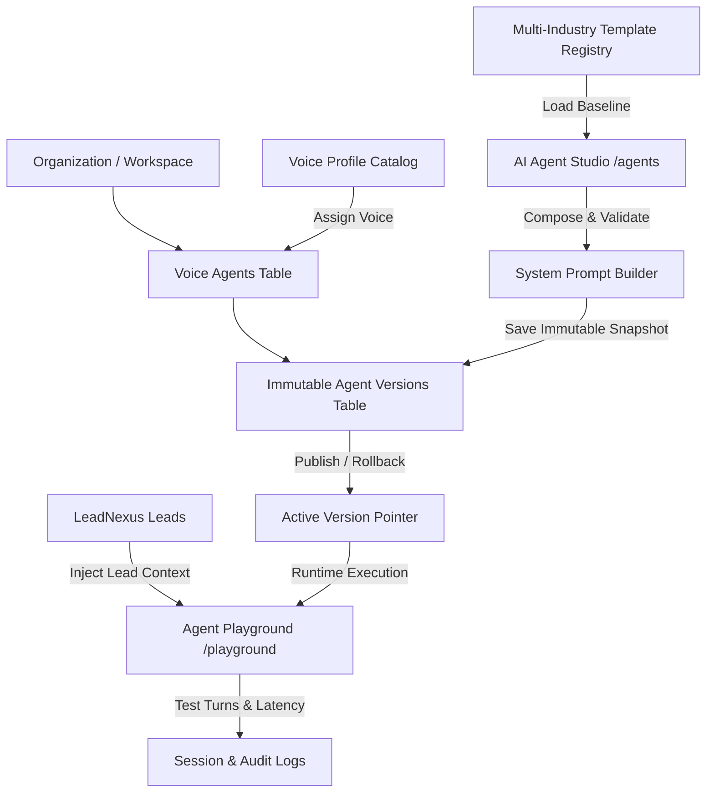

# VoiceNexus AI — Phase 5 Implementation Plan
## AI Agent Studio & Multi-Industry Prompt Versioning Engine

**Document Version:** 1.0.0  
**Phase Status:** Initiated  
**Module Scope:** AI Agent Studio, Versioning Engine, Industry Templates, Voice Profile Catalog, Playground & LeadNexus Integration  

---

## 1. Architectural Overview & Domain Mapping

In Phase 5, VoiceNexus AI transitions from a single-agent prototype into a multi-industry, enterprise-grade AI voice-agent orchestration platform. Organizations can provision, configure, version, compare, and test conversational agents across multiple industries before real-time audio transport is attached.

---

## 2. Canonical Database Schema Utilization

All Phase 5 capabilities map strictly to the existing 26-table canonical schema created in Phase 3 (`supabase/migrations/20261110000001_canonical_schema.sql`):

| Schema Table | Phase 5 Utilization |
| :--- | :--- |
| `public.voice_agents` | Stores multi-agent records scoped by `organization_id`, with `name`, `role_title`, `language_mode`, `voice_id`, `status` (`ACTIVE`, `DRAFT`, `PAUSED`, `ARCHIVED`), and pointer `active_version_id`. |
| `public.agent_versions` | Immutable snapshots with unique constraint `(agent_id, version_number)`. Contains `system_prompt`, `greeting_message`, `turn_timeout_ms`, `max_duration_seconds`, `tools_enabled`, `knowledge_context`, and `notes`. |
| `public.voice_profiles` | Catalog of voice profiles with `name`, `language`, `gender`, `provider` (`gnani`), `provider_voice_id`, and `is_custom_clone`. |
| `public.voice_profile_consents` | Tracks consent records (`speaker_name`, `consent_text`, `consented_at`) for ethical voice usage. |
| `public.leads` | Lead context source for playground testing and personalized variable injection. |
| `public.call_sessions` & `call_events` | Stores test playground session runs and turn audits. |

---

## 3. Work Breakdown Structure

### Module 1: Multi-Industry Agent Templates (`src/lib/agent-templates.ts`)
Eight comprehensive industry templates:
1. **Solar & Renewable Energy:** Feasibility qualification, tariff calculation, PM Surya Ghar subsidy guidance, site inspection booking.
2. **Real Estate & Construction:** Property type (villa/apartment/plot), budget bracket, location preference, site visit scheduling.
3. **Healthcare Appointment Enquiries:** Department routing (cardiology/ortho/general), doctor availability, consultation slot booking.
4. **Education & Admissions:** Course selection (undergrad/postgrad), eligibility requirements, campus tour booking, fee structure.
5. **Automobile Dealerships:** Vehicle model inquiry, test drive booking, exchange evaluation, financing pre-check.
6. **E-commerce & Retail:** Order tracking, return/exchange assistance, product recommendation, delivery SLA confirmation.
7. **Banking & Financial Services:** Loan eligibility (home/personal), interest rate explanation, document collection checklist.
8. **General B2B Lead Qualification:** Business size, decision maker identification, pain point discovery, demo scheduling.

### Module 2: Advanced System Prompt Builder (`src/lib/prompt-builder.ts`)
- Sectional modular builder: Role, Business Context, Objectives, Language Policy, Qualification Questions, Objection Handling, Escalation Rules, Closing.
- Dynamic variable placeholder validation:
  - Supported: `{{business_name}}`, `{{customer_name}}`, `{{business_industry}}`, `{{customer_interest}}`, `{{preferred_language}}`, `{{appointment_time}}`, `{{phone}}`, `{{city}}`.
  - Placeholder syntax check: catches unclosed braces or invalid tokens.
  - Non-empty prompt validation.

### Module 3: Versioning Engine & API Routes
- `POST /api/agents/[id]/versions`:
  - Increments version number (`v1.0` -> `v1.1` -> `v1.2` or major `v2.0`).
  - Writes an immutable record to `agent_versions`.
  - If `publish: true`, atomically updates `voice_agents.active_version_id`.
- `POST /api/agents/[id]/rollback`:
  - Points `active_version_id` back to an earlier historical version snapshot.
  - Never deletes or modifies historical version records.
- `GET /api/agents/[id]/versions`:
  - Returns complete version timeline with diff indicators.

### Module 4: Voice Profile Catalog (`src/lib/voice-profiles.ts`)
Catalog of Gnani Timbre voice options:
- `ta-IN-selvi`: Female, Tamil/Tanglish, Warm & Conversational
- `ta-IN-karthik`: Male, Tamil/Tanglish, Authoritative & Technical
- `en-IN-priya`: Female, Indian English, Professional B2B
- `hi-IN-aarav`: Male, Hindi/English, Energetic & Helpful
- `en-IN-ananya`: Female, Indian English, Empathic Healthcare
- `ta-IN-vikram`: Male, Tamil, Senior Advisory

### Module 5: LeadNexus Lead Context Integration
- Ability in the testing playground and agent studio to select a real lead from `public.leads`.
- Automatically populates `{{customer_name}}`, `{{customer_interest}}`, phone, and intent score into the testing session context.

### Module 6: Commercial UI in `/agents` & `/playground`
- **Agent Studio (`/agents`):**
  - High-density agent cards (active version, language mode, voice persona, status pill).
  - Create Agent Modal with Industry Template selector.
  - Tabbed Studio Workspace:
    1. *Prompt Builder* (with live token chips and syntax validator)
    2. *Language & Dialect* (`AUTO`, `TAMIL`, `TANGLISH`, `ENGLISH`)
    3. *Voice Persona* (catalog selector with consent metadata)
    4. *Safety & Escalation* (AI identity disclosure, DNC enforcement, max duration)
    5. *Version History & Diff* (side-by-side comparison of active vs selected version, rollback button)
- **Agent Playground (`/playground`):**
  - Interactive conversation testing drawer.
  - Predefined personas ("Hesitant Homeowner", "Aggressive Commercial Buyer", "DNC Opt-Out Tester").
  - Lead selector dropdown to test with real LeadNexus customer data.
  - Turn-by-turn latency measurement, resolved prompt inspector, and reasoning metadata.

---

## 4. Verification & Quality Gates

1. **Automated E2E Verification Script (`tests/agent_studio_e2e.ts`):**
   - 13-point test workflow covering agent creation, template loading, prompt building, version incrementing, version diffing, rollback, playground turn execution, and LeadNexus association.
2. **Standard Quality Gates:**
   - `npm run typecheck` (0 errors)
   - `npm run lint` (0 errors, 0 warnings)
   - `npm test` (all unit test suites passing)
   - `npm run build` (production build compiled cleanly)

