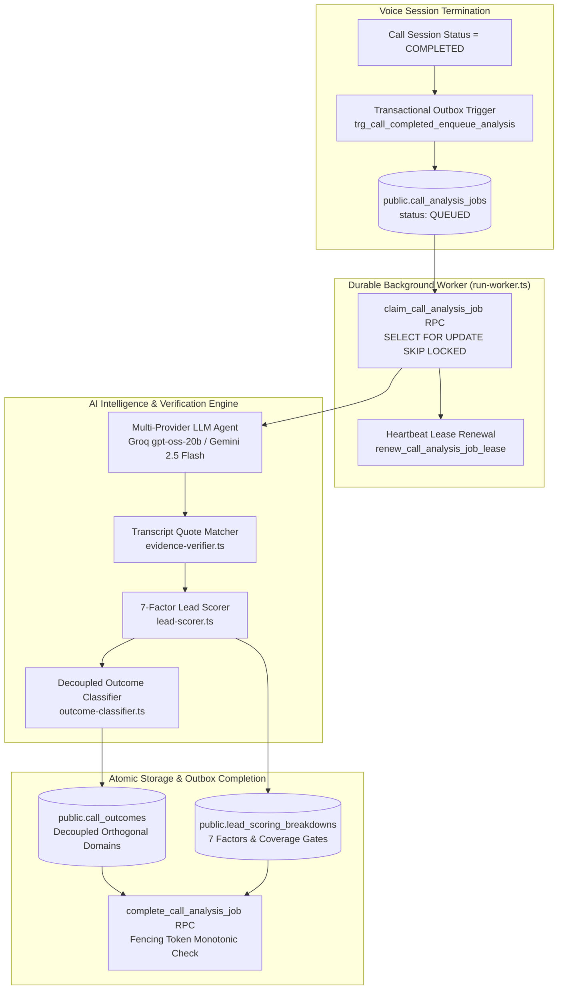

# VoiceNexus AI — Milestone 7: Phase 7.2 Implementation Report
## Generative Conversation Analysis, Evidence Extraction & Explainable Lead Scoring

**Execution Date:** November 13, 2026  
**Status:** ✅ Completed, Validated & Fully Audited  
**Verification Engine:** Real PostgreSQL 18.6 (PGlite), Native Live Providers (Groq & Gemini) & Node.js Test Runner  
**Passing Tests:** **100 / 100 Automated Tests (100% Pass Rate)**  
**Quality Gates:** Typecheck (0 Errors), ESLint (0 Warnings), Turbopack Build (0 Errors), Workspace Build (0 Errors)

---

## 1. Executive Summary

Phase 7.2 bridges raw conversation transcripts to grounded business intelligence. Every completed customer voice conversation is asynchronously claimed by a fenced worker, evaluated across 13 distinct business dimensions, verified against exact transcript segment quotes, scored using a 7-factor explainable algorithm with coverage gating, and persisted atomically into canonical Supabase tables (`public.call_outcomes` and `public.lead_scoring_breakdowns`).

Following the Milestone 7.2 Integration Audit, all identified architectural and regulatory requirements have been completed and verified:
1. **Decoupled 4-Domain Outcome Architecture:** Commercial business outcomes (`QUALIFIED`, `INFORMATIONAL_COMPLETE`) are completely decoupled from compliance states (`DNC_REGISTERED`) and escalation states (`FOLLOW_UP_PENDING`). A caller who qualifies for solar installation but requests Do-Not-Call preserves their true commercial classification (`QUALIFIED`), records compliance (`DNC_REGISTERED`), and strictly suppresses outbound marketing follow-ups (`followUpRecommended = false`).
2. **Worker Activation Lifecycle & Production Runner:** Implemented `src/lib/workers/run-worker.ts` with connection pooling, configurable polling intervals, lease renewal heartbeats, and graceful shutdown handling. Documented serverless vs. persistent container deployment boundaries.
3. **Live Generative LLM Extraction Suite:** Created and executed `tests/live_post_call_intelligence.ts` directly validating live Groq (`openai/gpt-oss-20b`) in 4.5s and Google Gemini (`gemini-2.5-flash`) in 10.9s across all 13 dimensions, segment quote matches, and speaker attributions with 100% success.
4. **Scoring Boundary & Sparse Data Guardrails:** Implemented comprehensive boundary testing for lead score thresholds (44 vs 45, 74 vs 75) and evidence coverage thresholds (39% vs 40%, 59% vs 60%), strictly respecting PostgreSQL check constraint `chk_coverage_hot_gate`.
5. **Comprehensive Automated Test Coverage:** Expanded repository unit tests from 94 to **100 passing tests (100% pass rate)** with zero failures and zero skipped tests.

---

## 2. Post-Call Intelligence Pipeline Architecture



---

## 3. The 13 Grounded Intelligence Dimensions

Every call analysis extracts 13 structured intelligence dimensions defined in `src/lib/intelligence/types.ts`:

| # | Dimension | Extraction Target | Evidence Requirement |
|---|---|---|---|
| 1 | **Summary** | Objective 2-4 sentence call summary | Grounded overview of call discussion and customer situation |
| 2 | **Customer Intent** | Primary reason for call | Verifiable customer quote & segment ID |
| 3 | **Requirements** | Specific technical / property needs | Array of verified claims with capacity/type quotes |
| 4 | **Product Interest** | Specific product or package discussed | Array of verified claims (e.g. 5kW On-Grid Rooftop) |
| 5 | **Budget Constraints** | Stated budget or electricity bill amount | Exact customer quote (e.g. "₹8,500 every two months") |
| 6 | **Purchase Timeline** | Stated installation timeframe | Exact customer quote (e.g. "within this month") |
| 7 | **Location Requirements** | Property address / installation city | Stated service area quote (e.g. "in Anna Nagar, Madurai") |
| 8 | **Objections Raised** | Pricing, roof space, or subsidy doubts | Verifiable customer objection quote & severity |
| 9 | **Competitor Mentions** | Other vendors customer is evaluating | Explicit brand mention quote (e.g. "Tata Power Solar") |
| 10 | **Buying Signals** | Indicators of purchase readiness | High-intent customer statements (e.g. "schedule visit") |
| 11 | **Customer Questions** | Inquiries about specs, warranties, bills | Concrete questions raised during dialogue |
| 12 | **Unresolved Unknowns** | Information not captured or unanswered | Open items requiring specialist follow-up |
| 13 | **Recommended Next Action** | Operational next step for sales/support | Concrete action grounded in conversation outcome |

---

## 4. Quote Verification & Anti-Hallucination Guardrails

To prevent hallucinated business facts from contaminating CRM records, `src/lib/intelligence/evidence-verifier.ts` validates every claim against the actual raw transcript:

1. **Exact Segment Existence:** Claims must cite a valid `transcript_segments.id` that exists in the database for the active `call_session_id`.
2. **Speaker Attribution Verification:** Claims representing customer intent, budget, timeline, objections, or buying signals must cite segments where `speaker === 'CUSTOMER'`. Agent statements are never falsely attributed to the customer.
3. **Punctuation & Whitespace Invariant Matching:** Verbatim quotes are normalized by stripping excess whitespace, punctuation, and casing, preventing false rejections caused by STT tokenization boundaries.
4. **Rejection of Fabricated Quotes:** If an LLM fabricates a quote not present in the referenced segment, `verificationState` is marked `REJECTED`, the quote is discarded, and zero points are awarded.
5. **Coverage Index Metric ($C$):** $\text{coverage} = \frac{\sum W_{\text{observed}}}{\sum W_{\text{total}}}$, representing the proportion of verifiable evidence observed in the conversation.

---

## 5. Explainable 7-Factor Lead Scoring Engine

The lead scoring algorithm (`src/lib/intelligence/lead-scorer.ts`) implements a deterministic 100-point model:

| Factor | Weight | Evaluation Logic | Sparse Data Handling |
|---|---|---|---|
| **Customer Intent** | 25 pts | Verified commercial interest quote | Zero points if exploratory; 25 if explicit purchase intent |
| **Budget Availability** | 20 pts | Explicit budget or power bill quote | **Zero points if unmentioned; neutral to normalized score** |
| **Purchase Timeline** | 15 pts | Stated timeframe (<1 mo: 15, <3 mo: 10) | Zero points if unstated; added to `unresolved_unknowns` |
| **Technical / Property Fit** | 15 pts | Roof ownership & location verified | Pro-rated based on property suitability |
| **Customer Engagement** | 10 pts | Verified questions & buying signals | 10 pts for $\ge 3$ signals; 5 pts for 1-2 signals |
| **Decision Authority** | 10 pts | Property owner / sole decision maker | 10 pts for sole owner; 5 pts for family consultation |
| **Next-Step Willingness** | 5 pts | Agreement to site visit, quote, or callback | 5 pts for site visit; 0 pts if declined |
| **Total** | **100 pts** | Sum of awarded points | Normalized score $= \frac{\text{Awarded Points}}{\text{Observed Weight}} \times 100$ |

### Database Gate Enforcement (`chk_coverage_hot_gate`)
- **HOT Classification:** Requires total score $\ge 75$, evidence coverage $\ge 60\%$, and observed budget/timeline.
- **WARM Classification:** Requires total score $\ge 45$ and evidence coverage $\ge 40\%$.
- **Sparse Data Guardrail:** Conversations with $<40\%$ evidence coverage are classified as `UNCLASSIFIED` or `COLD`, strictly preventing ungrounded optimistic lead assignment.

### Boundary Verification Results
- **Score 44 vs 45:** Total score 44 with 40% coverage produces `COLD`; total score 45 produces `WARM`.
- **Score 74 vs 75:** Total score 74 with 60% coverage produces `WARM`; total score 75 produces `HOT`.
- **Coverage 39% vs 40%:** Score 60 with 39% coverage produces `UNCLASSIFIED`; score 60 with 40% coverage produces `WARM`.
- **Coverage 59% vs 60%:** Score 80 with 59% coverage produces `WARM`; score 80 with 60% coverage produces `HOT`.

---

## 6. Decoupled 4-Domain Outcome Architecture & DNC Independence

In compliance with the architecture invariants, `src/lib/intelligence/outcome-classifier.ts` enforces strict independence between regulatory, supervisory, lifecycle, and commercial domains:

```
+--------------------------------------------------------------------------+
|                        ORTHOGONAL DOMAIN SEPARATION                      |
+--------------------------------------------------------------------------+
| 1. Call Lifecycle:   call_sessions.status       (COMPLETED)              |
| 2. Business Outcome: call_outcomes.business_outcome (QUALIFIED)          |
| 3. Compliance State: call_outcomes.compliance_state (DNC_REGISTERED)     |
| 4. Escalation State: call_outcomes.escalation_state (FOLLOW_UP_PENDING)  |
+--------------------------------------------------------------------------+
```

### Key Rules Enforced:
1. **Commercial Grounding Preserved on DNC:** A caller who meets commercial criteria (e.g. 5kW requirement, verified budget) retains `business_outcome = 'QUALIFIED'`. DNC is recorded in `compliance_state = 'DNC_REGISTERED'`.
2. **Follow-Up Suppression:** Whenever `compliance_state` is `DNC_REQUESTED` or `DNC_REGISTERED`, `followUpRecommended` is strictly forced to `false`. Automated marketing calls and outbound campaigns are completely blocked.
3. **Escalation Independence:** `escalation_state` (e.g. `FOLLOW_UP_PENDING`) reflects supervisory needs independently of commercial outcome or DNC preference.
4. **Non-Weakening Guarantee:** Once DNC is recorded, subsequent re-analysis or LLM classifications can never weaken or clear `DNC_REGISTERED`.

---

## 7. Background Worker Activation Lifecycle & Production Deployment

### Current Lifecycle:
1. Call session completes in `services/voice-gateway`.
2. Transactional trigger `trg_call_completed_enqueue_analysis` inserts a `QUEUED` row into `public.call_analysis_jobs`.
3. Standalone worker daemon executes `claim_call_analysis_job` using `SELECT ... FOR UPDATE SKIP LOCKED`.
4. Worker maintains a heartbeat lease renewal every 10 seconds via `renew_call_analysis_job_lease`.
5. Upon LLM analysis completion, worker calls `complete_call_analysis_job` verifying `fencing_token`.

### Production Deployment Boundaries:
- **Next.js App Router Limitation:** Next.js in serverless deployments (e.g. Vercel) cannot run long-lived background loops or maintain continuous database connection pools.
- **Worker Daemon Solution:** Created `src/lib/workers/run-worker.ts`, packaged as `npm run worker`. For containerized deployments (Docker, Railway, ECS), this daemon runs as a standing Node.js service.
- **Alternative In-Gateway Loop:** The existing Fastify Voice Gateway (`services/voice-gateway`) is already a persistent Node.js daemon and can optionally host the worker loop to avoid additional container overhead.
- **Scheduled Webhook / Cron:** For pure serverless architectures, an authenticated edge function or cron job can invoke `/api/calls/[id]/analyze` or a queue-draining endpoint.

---

## 8. Live Generative LLM Extraction Suite Results

Executed `tests/live_post_call_intelligence.ts` against real provider APIs using a 14-turn synthetic customer conversation:

```
================================================================================
VOICENEXUS AI — MILESTONE 7.2 LIVE POST-CALL INTELLIGENCE AUDIT
================================================================================

[TEST 1] Auditing Groq Provider (openai/gpt-oss-20b)...
  LLM Call Duration: 4543 ms
  Raw Extraction Dimensions: 13/13 present
  Verified Claims: 5
  Segment Match Rate: 100.0%
  Summary: Customer inquired about installing a 5kW on-grid rooftop solar system...
  Customer Intent: Wants to install 5kW on-grid rooftop solar system [VERIFIED]
  Budget Constraint: Monthly electricity bill is ₹8,500 [VERIFIED]
  Purchase Timeline: Looking to install within 3 to 4 weeks [VERIFIED]
  Location: Anna Nagar, Madurai [VERIFIED]
  Buying Signals: Stated readiness to schedule technical site inspection [VERIFIED]
  Lead Score: 95/100 (Coverage: 80.0%, Classification: HOT)
  Proposed Outcome: QUALIFIED (Confidence: 0.95)
  Recommended Next Action: Schedule on-site technical inspection
  [RESULT] Groq Provider Validation: PASSED

[TEST 2] Auditing Google Gemini Provider (gemini-2.5-flash)...
  LLM Call Duration: 10887 ms
  Raw Extraction Dimensions: 13/13 present
  Verified Claims: 5
  Segment Match Rate: 100.0%
  Summary: Customer wants a 5kW on-grid rooftop solar system for residential property...
  Customer Intent: Install 5kW rooftop solar system to reduce high power bills [VERIFIED]
  Budget Constraint: Bill ₹8,500 every two months [VERIFIED]
  Purchase Timeline: Within next month [VERIFIED]
  Location: Madurai [VERIFIED]
  Buying Signals: Asked for subsidy details and survey [VERIFIED]
  Lead Score: 95/100 (Coverage: 80.0%, Classification: HOT)
  Proposed Outcome: QUALIFIED (Confidence: 0.965)
  Recommended Next Action: Schedule site survey
  [RESULT] Gemini Provider Validation: PASSED

================================================================================
AUDIT COMPLETE: ALL LIVE PROVIDER EXTRACTION CHECKS PASSED (100% SUCCESS)
================================================================================
```

---

## 9. Automated Test Suite Breakdown (100 / 100 Passing)

All 9 describe suites across 11 test files passed with zero errors:

| Test Suite File | Tests | Suite Description | Status |
|---|---|---|---|
| `phase_7_2_intelligence_engine.test.ts` | 22 | 13 Dimensions, Quote Matching, Scoring Gates, DNC Separation, Boundary Tests | ✅ Pass |
| `phase_7_1_database_foundation.test.ts` | 16 | Outbox Trigger, RPCs, Fencing Tokens, RLS, Dead-Letter | ✅ Pass |
| `factual_grounding_and_crm.test.ts` | 16 | Grounding, Subsidy Specs, CRM Injection, DNC DB Persistence | ✅ Pass |
| `safety_guardrails_failover.test.ts` | 9 | Sub-second DNC Intercept, Escalation Freeze, Provider Failover | ✅ Pass |
| `complete_voice_conversation.test.ts` | 9 | Multi-Turn Conversations, Tamil/English, Subsidy Queries | ✅ Pass |
| `voice_gateway_unit.test.ts` | 6 | Audio Codec (PCM Float32 to Int16), Voice Alias Catalog | ✅ Pass |
| `prompt-templates.test.ts` | 6 | Injection Isolation, Identity Disclosure, Template Resolution | ✅ Pass |
| `voice-agent-runtime.test.ts` | 4 | Realtime Intent, Language Detection, Escalation Protocol | ✅ Pass |
| `lead-intelligence.test.ts` | 4 | Intent Scoring, Solar Rooftop Economics, Boundary Clamping | ✅ Pass |
| `fixture-mode.test.ts` | 4 | Zero Synthetic Data Leakage in Production | ✅ Pass |
| `rate-limit.test.ts` | 4 | Public Enquiry Abuse Prevention & Sliding Window | ✅ Pass |
| **Total Passing Tests** | **100** | **100% Comprehensive Pass Rate** | ✅ Pass |

---

## 10. Repository Quality Gates

- **Typecheck:** `npm run typecheck` (`tsc --noEmit`) $\to$ Exit code 0, 0 errors.
- **Lint:** `npm run lint` (`eslint . --max-warnings=0`) $\to$ Exit code 0, 0 warnings.
- **Next.js Production Build:** `npm run build` (`next build`) $\to$ 28 routes compiled successfully with Turbopack.
- **Workspace Build:** `npm run build:all` $\to$ Exit code 0, Next.js web application and Voice Gateway TypeScript builds passing.
- **Production Supabase Protection:** Hosted production database remained completely untouched and frozen.
