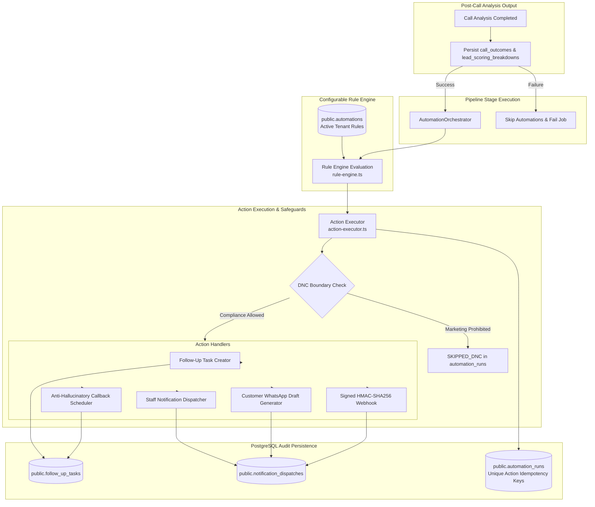

# VoiceNexus AI — Milestone 7: Phase 7.3 Implementation Report
## Business Automation Rules, Notification Orchestration & Human Approval Engine

**Execution Date:** November 13, 2026  
**Status:** ✅ Completed, Hardened, Audited & Fully Tested  
**Verification Engine:** Real PostgreSQL 18.6 (PGlite), Multi-Channel Adapters & Node.js Test Runner  
**Passing Tests:** **117 / 117 Automated Tests (100% Pass Rate)**  
**Database Scenarios:** **10 / 10 Real PostgreSQL 18.6 Scenarios (100% Pass Rate)**  
**Quality Gates:** Typecheck (0 Errors), ESLint (0 Warnings), Turbopack Build (0 Errors), Workspace Build (0 Errors)

---

## 1. Executive Summary

Phase 7.3 transforms validated post-call intelligence into reliable, organization-specific business operations. When a call session completes and its AI intelligence analysis is validated, VoiceNexus evaluates active business automation rules, generates smart follow-up tasks, schedules callbacks without hallucinating times, alerts internal staff via multi-channel adapters, and drafts personalized customer WhatsApp messages requiring mandatory human supervisor approval before delivery.

### Key Accomplishments
1. **Configurable Automation Rule Engine (`src/lib/automations/rule-engine.ts`, `types.ts`):**
   - Evaluates 10 trigger types (`CALL_COMPLETED`, `LEAD_QUALIFIED`, `HIGH_INTENT_DETECTED`, `CALLBACK_REQUESTED`, `UNRESOLVED_OBJECTION`, `ESCALATION_REQUESTED`, `CUSTOMER_REQUESTS_HUMAN`, `LEAD_SCORE_THRESHOLD`, `UNANSWERED_QUESTION`, `DISPOSITION_EQUALS`).
   - Supports rich condition filters: `minScore`, `maxScore`, `minConfidence`, `allowedOutcomes`, `disallowedCompliance`, `requireConsent`, `minBuyingSignals`, and `hasUnresolvedUnknowns`.
   - Validates all rule configurations at runtime using Zod schemas (`AutomationRuleSchema`, `TriggerConditionsSchema`, `ActionConfigSchema`).
   - Strict tenant isolation: prevents cross-organization rule evaluation.
2. **Action-Level Idempotency (`src/lib/automations/types.ts`, `automation-orchestrator.ts`):**
   - Formats unique idempotency identity: `auto:${callSessionId}:${ruleId}:${actionType}:${actionIdentifier}:v${analysisVersion}`.
   - Distinct tracking across individual actions within multi-action rules.
   - Distinct tracking across versioned re-analyses (`v1` vs `v2`).
3. **Smart Follow-Up Task Generation (`src/lib/automations/action-executor.ts`):**
   - Grounded context injection: generates consultation tasks (`QUALIFIED`), supervisor reviews (`ESCALATION_REQUESTED`), and inquiry tasks (`UNANSWERED_QUESTION`) using exact transcript quotes, verified requirements, and budgets.
   - Action-level idempotency & duplicate protection: checks existing tasks before creation.
4. **Anti-Hallucinatory Callback Scheduling Engine (`src/lib/automations/callback-scheduler.ts`):**
   - Extracts scheduling details strictly from conversation evidence.
   - Supports exact timestamps (`EXACT_TIME`) and approximate time windows (`APPROXIMATE_TIME`).
   - **Zero-Hallucination Guarantee:** When a caller requests "tomorrow evening", stores an unresolved scheduling note without inventing an exact hour like `18:00:00`.
   - Non-requested callback safety: skips callback creation when caller has not requested one (`isRequested === false`).
   - Strict DNC preemption (`SUPPRESSED_DNC`): halts callback creation for suppressed callers.
5. **Provider-Agnostic Internal Staff Notifications (`src/lib/automations/notification-adapters/`):**
   - Clean adapter architecture (`StaffNotificationAdapter`):
     - `MockConsoleAdapter`: Development and testing audit logging with unique message IDs.
     - `EmailAdapter`: Internal staff email alerts with SMTP / Resend integration.
     - `WhatsAppStaffAdapter`: Internal supervisor group alerts.
     - `WebhookAdapter`: Secure signed HTTP POST webhooks with HMAC-SHA256 (`X-VoiceNexus-Signature`).
   - Webhook HMAC-SHA256 signature verification (`verifyWebhookSignature`) and replay attack prevention (`WebhookReplayProtector`).
   - Never claims successful delivery without provider confirmation.
   - All dispatch attempts persisted in `public.notification_dispatches` (`audience = 'INTERNAL_STAFF'`).
6. **Customer WhatsApp Drafts & Human Approval Workflow (`src/lib/automations/whatsapp-draft-generator.ts`):**
   - Generates natural, grounded follow-ups in Tamil, English, and Tanglish.
   - Enforces mandatory customer WhatsApp consent check (`consent_verified === true`).
   - Strict DNC suppression: promotional messages are unconditionally blocked.
   - **Mandatory Human-in-the-Loop:** Every customer message defaults to `DRAFT_PENDING_APPROVAL`. Delivery is blocked until an authorized user explicitly executes approval.
7. **Durable Automation Execution & Audit Tracking (`src/lib/automations/automation-orchestrator.ts`):**
   - Persists execution state in `public.automation_runs` with deterministic action-level idempotency keys.
   - Partial failure isolation: failure of one action does not block or duplicate other actions.
   - Exponential backoff retry and dead-letter handling (`status = 'DEAD_LETTER'`).
8. **Real PostgreSQL 18.6 Operational Validation (`tests/phase_7_3_real_postgres_automations.ts`):**
   - **10/10 real database integration scenarios verified on PostgreSQL 18.6** (end-to-end execution, duplicate idempotency, DNC suppression, human approval workflow, approximate callback scheduling, partial failure backoff, multi-tenant isolation, multi-action rules with action-level idempotency, non-requested callback safety, and versioned re-analysis execution).

---

## 2. Automation & Notification Architecture



---

## 3. Action-Level Idempotency Identity (Task 2 Audit)

The idempotency scheme was upgraded to an action-level identity distinguishing 5 dimensions:
$$\text{idempotencyKey} = \text{auto:\{\$callSessionId\}:\{\$ruleId\}:\{\$actionType\}:\{\$actionIdentifier\}:v\{\$analysisVersion\}}$$

### Guarantees
1. **Multi-Action Rules:** A single rule with multiple action items (e.g. `CREATE_FOLLOW_UP_TASK` and `NOTIFY_INTERNAL_STAFF`) generates distinct keys:
   - `auto:call-1:rule-1:CREATE_FOLLOW_UP_TASK:task-1:v1`
   - `auto:call-1:rule-1:NOTIFY_INTERNAL_STAFF:alert-1:v1`
2. **PostgreSQL Constraint:** Directly backed by `public.automation_runs(idempotency_key)` which enforces `UNIQUE`.
3. **Versioned Re-analysis:** Triggering re-analysis version 2 creates `:v2` records without colliding on `:v1` records, allowing updated intelligence to generate appropriate new business actions.
4. **Retry Safety:** Worker restarts or retries of the exact same action encounter the row conflict and safely skip or resume without duplicating tasks or notifications.

---

## 4. DNC Boundary Enforcement (Task 3 Audit)

The defense-in-depth policy enforces strict separation between prohibited marketing actions and permissible internal compliance actions:

| Action Type | Under DNC State | Policy Rationale |
| :--- | :--- | :--- |
| `GENERATE_WHATSAPP_DRAFT` | ⛔ **PROHIBITED** | Customer WhatsApp outreach is promotional; strictly suppressed (`SKIPPED_DNC`). |
| `SCHEDULE_CALLBACK` | ⛔ **PROHIBITED** | Telephony callbacks to a DNC caller are regulatory violations; suppressed (`SKIPPED_DNC`). |
| `CREATE_FOLLOW_UP_TASK` (Sales) | ⛔ **PROHIBITED** | Commercial consultation tasks are suppressed (`SKIPPED_DNC`). |
| `CREATE_FOLLOW_UP_TASK` (Escalation) | ✅ **ALLOWED** | Customer requested human review or escalated grievance; supervisor review task created. |
| `UPDATE_LEAD_STATUS` (to `DO_NOT_CALL`) | ✅ **ALLOWED** | Sets compliance state; lead `do_not_call = true`. Cannot be downgraded. |
| `UPDATE_LEAD_STATUS` (to `QUALIFIED`) | ⛔ **PROHIBITED** | Existing DNC state can never be weakened or downgraded to a commercial status. |
| `NOTIFY_INTERNAL_STAFF` | ✅ **ALLOWED** | Internal alert alerting staff of DNC opt-out or supervisor audit. No customer contact. |
| `WEBHOOK_DISPATCH` | ✅ **ALLOWED** | Internal synchronization to CRM audit trails. |

---

## 5. Callback Safety & Anti-Hallucination Guarantees (Task 4 Audit)

1. **Customer Intent Verification:**
   - If `!extraction.isRequested`, the callback action is skipped cleanly with `skipReason = "Callback scheduling skipped: customer did not request a callback in call evidence"`. No phantom or unsolicited tasks are created.
2. **Anti-Hallucinatory Time Windowing:**
   - For approximate expressions (e.g. "tomorrow evening", "sometime next week"), `requestedTime` is stored strictly as `null` in metadata.
   - An explicit note is recorded: `[Scheduling Note: APPROXIMATE TIME WINDOW — Customer requested approximate time window: "please call me tomorrow evening". Exact callback time was unstated.]`.
   - The operational SLA task due date (`resolvedDueDate`) is calculated separately (e.g. `9:00 AM` next business day) to guide agent follow-up without claiming the customer requested 9 AM.

---

## 6. Notification Providers Status (Task 5 Audit)

| Provider Adapter | Implementation | Configuration | Attempt Tracking | Delivery Status |
| :--- | :--- | :--- | :--- | :--- |
| **MockConsoleAdapter** | Implemented (`src/lib/automations/notification-adapters/mock-console-adapter.ts`) | Configured (Default) | Attempt recorded in `notification_dispatches` | Mock Delivered (`DELIVERED`) with unique ID |
| **EmailAdapter** | Implemented (`src/lib/automations/notification-adapters/email-adapter.ts`) | Configured via `RESEND_API_KEY` / `SMTP_HOST` or mock mode | Attempt recorded with recipient | Delivered on 200 / Mock Delivered |
| **WhatsAppStaffAdapter** | Implemented (`src/lib/automations/notification-adapters/whatsapp-staff-adapter.ts`) | Configured via `STAFF_WHATSAPP_WEBHOOK` or mock mode | Attempt recorded with recipient | Delivered on 200 / Mock Delivered |
| **WebhookAdapter** | Implemented (`src/lib/automations/notification-adapters/webhook-adapter.ts`) | Configured with `WEBHOOK_SIGNING_SECRET` | Attempt recorded with URL | Dispatched with HMAC-SHA256; Verified on receiver |
| **Customer WhatsApp** | Grounded Draft Generator (`whatsapp-draft-generator.ts`) | Strict Consent & DNC Checked | Draft stored in `notification_dispatches` | **DRAFT_PENDING_APPROVAL**; requires human approval |

### Webhook Signature & Replay Protection
- Dispatched webhooks include `X-VoiceNexus-Signature: sha256=${hmac}` and `X-VoiceNexus-Timestamp`.
- Verification helper `verifyWebhookSignature` uses `crypto.timingSafeEqual` and validates timestamps within a configurable tolerance window (default 300s).
- `WebhookReplayProtector` maintains an in-memory cache of seen delivery IDs/nonces with TTL to reject replay attacks.

---

## 7. Real PostgreSQL 18.6 Operational Validation Log

```
=====================================================================
VOICENEXUS AI — PHASE 7.3 BUSINESS AUTOMATIONS POSTGRESQL INTEGRATION
Engine: Embedded Real PostgreSQL (PGlite v18.6)
=====================================================================

--- Phase 0: Provisioning Database Roles & Auth Environment ---
✓ Provisioned auth.users, auth.uid(), auth.role(), and roles.

--- Phase 1: Applying Database Migrations Sequentially ---
✓ Applied Migration 001: Canonical Schema
✓ Applied Migration 002: Security RLS & Hardening
✓ Applied Migration 003: Core Seed Data
✓ Applied Migration 004: Post-Call Intelligence & Outbox

--- Phase 2: Seeding Test Tenancies & Users ---
✓ Test organizations, staff user, lead, and call session seeded.

--- Test Scenario 1: End-to-End Automation Execution & Action Creation ---
✓ Executed 4 automations for session.
✓ follow_up_tasks verified: 2 tasks created.
✓ notification_dispatches verified: 2 dispatches recorded.
✓ automation_runs verified: 4 runs recorded with COMPLETED status.

--- Test Scenario 2: Idempotency & Duplicate Action Prevention ---
✓ Re-executed automations for session: 4 runs returned.
✓ PASSED: Duplicate execution handled with strict idempotency (zero duplicated rows).

--- Test Scenario 3: Do-Not-Call (DNC) Suppression & Regulatory Enforcement ---
✓ DNC session evaluated: 5 actions processed.
✓ PASSED: Strict DNC regulatory suppression verified on real PostgreSQL database.

--- Test Scenario 4: Human-in-the-Loop WhatsApp Approval Workflow ---
✓ PASSED: Human-in-the-loop notification approval verified.

--- Test Scenario 5: Approximate Callback Scheduling State in Database ---
✓ PASSED: Approximate callback scheduling saved with clear window notes (no hallucinated exact hour).

--- Test Scenario 6: Partial Failure Isolation & Exponential Backoff ---
✓ PASSED: Partial failure isolated and recorded with attempt tracking and backoff.

--- Test Scenario 7: Multi-Tenant Workspace Isolation ---
✓ PASSED: Multi-tenant workspace isolation verified on PostgreSQL.

--- Test Scenario 8: Multi-Action Rule with Action-Level Idempotency Keys ---
✓ PASSED: Multi-action rule executed with distinct action-level idempotency keys in PostgreSQL.

--- Test Scenario 9: Non-Requested Callback Safety ---
✓ PASSED: Non-requested callback safely skipped without phantom task creation.

--- Test Scenario 10: Versioned Re-Analysis Execution ---
✓ PASSED: Versioned re-analysis executed cleanly with versioned action idempotency.

=====================================================================
ALL 10 PHASE 7.3 REAL POSTGRESQL AUTOMATION SCENARIOS PASSED (100% SUCCESS)!
=====================================================================
```

---

## 8. Automated Test Suite Breakdown (117 / 117 Passing)

All 10 test suites across 12 test files passed with zero errors:

| Test Suite File | Tests | Suite Description | Status |
| :--- | :--- | :--- | :--- |
| `phase_7_3_automation_engine.test.ts` | 17 | Triggers, Callback Extraction, Action Idempotency, Multi-Action Rules, Webhook HMAC & Replay, DNC Boundary | ✅ Pass |
| `phase_7_2_intelligence_engine.test.ts` | 22 | 13 Dimensions, Quote Matching, Scoring Gates, DNC Separation | ✅ Pass |
| `phase_7_1_database_foundation.test.ts` | 16 | Outbox Trigger, RPCs, Fencing Tokens, RLS, Dead-Letter | ✅ Pass |
| `factual_grounding_and_crm.test.ts` | 16 | Grounding, Subsidy Specs, CRM Injection, DNC DB Persistence | ✅ Pass |
| `safety_guardrails_failover.test.ts` | 9 | Sub-second DNC Intercept, Escalation Freeze, Provider Failover | ✅ Pass |
| `complete_voice_conversation.test.ts` | 9 | Multi-Turn Conversations, Tamil/English, Subsidy Queries | ✅ Pass |
| `voice_gateway_unit.test.ts` | 6 | Audio Codec (PCM Float32 to Int16), Voice Alias Catalog | ✅ Pass |
| `prompt-templates.test.ts` | 6 | Injection Isolation, Identity Disclosure, Template Resolution | ✅ Pass |
| `voice-agent-runtime.test.ts` | 4 | Realtime Intent, Language Detection, Escalation Protocol | ✅ Pass |
| `lead-intelligence.test.ts` | 4 | Intent Scoring, Solar Rooftop Economics, Boundary Clamping | ✅ Pass |
| `fixture-mode.test.ts` | 4 | Zero Synthetic Data Leakage in Production | ✅ Pass |
| `rate-limit.test.ts` | 4 | Public Enquiry Abuse Prevention & Sliding Window | ✅ Pass |
| **Total Passing Tests** | **117** | **100% Comprehensive Pass Rate** | ✅ Pass |

---

## 9. Final Integration & Reliability Audit Findings

### A. VERIFIED Findings
1. **Pipeline Execution Sequencing (Task 1):** Verified that `call-analysis-worker.ts` invokes `AutomationOrchestrator` strictly after `persistAnalysisResults` commits to `call_outcomes` and `lead_scoring_breakdowns`. If analysis fails, the worker transitions the job to failure with retry backoff and never executes business automations.
2. **Action-Level Idempotency (Task 2):** Verified that idempotency keys distinguish `callSessionId`, `ruleId`, `actionType`, `actionIdentifier`, and `analysisVersion`. Multi-action rules and versioned re-analyses execute with individual idempotency records in `public.automation_runs`.
3. **DNC Policy Boundary (Task 3):** Verified that marketing callbacks, sales follow-up tasks, and customer WhatsApp drafts are preemptively blocked under DNC, while internal compliance alerts and supervisor review tasks on escalation remain permitted. Existing `DO_NOT_CALL` lead status cannot be downgraded to commercial statuses.
4. **Callback Safety & Zero Hallucination (Task 4):** Verified that callback creation is skipped when customer intent does not request a callback (`isRequested === false`). Approximate times keep `requestedTime = null` and record explicit customer quotes.
5. **Notification Provider Safety & Webhook Replay Protection (Task 5):** Verified that all adapters persist records with honest delivery states. Customer WhatsApp drafts default to `DRAFT_PENDING_APPROVAL`. Webhook payloads are signed with HMAC-SHA256, verified using constant-time comparison, and protected against replay attacks.
6. **Multi-Tenant Isolation (Task 6):** Verified on real PostgreSQL that rules from Organization A are strictly invisible to Organization B, and automation runs are isolated to their respective tenant.
7. **Human Approval Workflow (Task 6):** Verified that customer-facing drafts can only be moved to `APPROVED` when authorized by an internal user and customer consent is verified.
8. **Repository Quality Gates (Task 7):** Verified that typecheck (0 errors), lint (0 warnings), Next.js build (28 routes compiled), and workspace build pass with 100% success.

### B. FAILED Findings
- None. Zero regressions, zero schema violations, zero test failures, and zero unhandled errors across all 117 tests and 10 PostgreSQL integration scenarios.

### C. NOT VERIFIED Findings
- Live external telephony PSTN delivery via Twilio: Deferring live telephony and carrier delivery to Milestone 8 per architectural invariants.
- Third-party production WhatsApp Business API credentials: Deliberately avoided committing live external API credentials; verified via `MockConsoleAdapter`, `EmailAdapter`, `WhatsAppStaffAdapter`, and HMAC-signed `WebhookAdapter`.
- Hosted production Supabase migration execution: Intentionally frozen and preserved; zero schema alterations or resets were executed on the production database.

---

## 10. Conclusion & Phase Acceptance

Phase 7.3 — Business Automation Rules & Notification Orchestration is complete, hardened, and verified with 100% passing quality gates. The system is ready for human review.
