# VoiceNexus AI — Comprehensive Technical Documentation

This document provides a detailed technical reference of the VoiceNexus AI architecture, verified Gnani AI integrations, telephony state machines, AI turn runtime, and post-call intelligence systems.

---

## 1. Gnani AI Speech Engine Integration

VoiceNexus AI integrates official Gnani AI speech models from the Vachana platform (`api.vachana.ai`).

### A. Speech Synthesis (Gnani Timbre TTS)
- **WebSocket Streaming Endpoint**: `wss://api.vachana.ai/api/v1/tts`
- **REST Inference Endpoint**: `https://api.vachana.ai/api/v1/tts/inference`
- **Voice Clone Endpoint**: `https://api.vachana.ai/api/v1/tts/voice-clone/embeddings`
- **Supported Models**:
  - `timbre-v2.5`: High-performance regional synthesis (750ms–1400ms latency) optimized for Indian languages.
  - `timbre-v3.0`: Flagship multilingual Indic model with natural code-mixing and conversational flow.
- **WebSocket Request Payload**:
  ```json
  {
    "text": "வணக்கம்! காவேரி சோலார் நிறுவனத்திலிருந்து அஸ்மிதா பேசுகிறேன்.",
    "voice": "Asmita",
    "model": "timbre-v2.5",
    "language": "ta-IN",
    "speed": 1.0,
    "audio_config": {
      "sample_rate": 16000,
      "num_channels": 1,
      "sample_width": 2,
      "encoding": "linear_pcm",
      "container": "wav"
    }
  }
  ```
- **Integrity Validation**:
  - Validates 44-byte RIFF/WAVE header, 16-bit Linear PCM encoding, mono channel, 16 kHz sample rate, and non-empty payload (>1000 bytes).
  - Automatically discards incomplete chunks upon timeout, guaranteeing that truncated audio is never served.

### B. Verified Gnani Timbre Voice Catalog

| ID | Persona | Language | Gender | Model | Tone & Use Case |
| :--- | :--- | :--- | :--- | :--- | :--- |
| `ta-IN-asmita` | **Asmita** (Default) | Tamil / Tanglish | Female | `timbre-v2.5` | Warm, conversational, local rooftop solar consultation |
| `ta-IN-kaveri` | **Kaveri** | Tamil | Female | `timbre-v2.5` | Professional, commercial EPC consultation |
| `ta-IN-suresh` | **Suresh** | Tamil | Male | `timbre-v2.5` | Authoritative engineering specialist |
| `hi-IN-ananya` | **Ananya** | Hindi | Female | `timbre-v2.5` | Polite, Hindi conversational outreach |
| `hi-IN-deepak` | **Deepak** | Hindi | Male | `timbre-v2.5` | High-energy customer support and sales |
| `en-IN-priya` | **Priya** | Indian English | Female | `timbre-v2.5` | Corporate, enterprise business executive |
| `en-IN-rohit` | **Rohit** | Indian English | Male | `timbre-v2.5` | Technical sales and project management |
| `te-IN-chitra` | **Chitra** | Telugu | Female | `timbre-v2.5` | Professional Telugu support & solar quotes |
| `te-IN-girish` | **Girish** | Telugu | Male | `timbre-v2.5` | Conversational commercial outreach |
| `kn-IN-vidya` | **Vidya** | Kannada | Female | `timbre-v2.5` | Natural Bangalore/Karnataka business advisory |
| `ml-IN-reshma` | **Reshma** | Malayalam | Female | `timbre-v2.5` | Empathetic customer care in Malayalam |
| `indic-auto-shivani` | **Shivani** | Multilingual Indic | Female | `timbre-v3.0` | Flagship code-mixing model across Indian languages |
| `indic-auto-avinash` | **Avinash** | Multilingual Indic | Male | `timbre-v3.0` | Executive masculine consultation across Indic dialects |

### C. Speech Recognition (Gnani Prisma STT)
- **WebSocket Streaming Endpoint**: `wss://api.vachana.ai/stt/v3/stream`
- **REST Endpoint**: `https://api.vachana.ai/stt/v3`
- **Models**: `prisma-v3.0` (with `indic-auto` automatic language identification) and `prisma-v2.5`.
- **WebSocket Configuration Headers**:
  - `x-api-key-id`: Server API Key ID
  - `language_code`: `"indic-auto"` or specific language code (`"ta-IN"`, `"hi-IN"`, etc.)
  - `model`: `"prisma-v3.0"`
  - `x-sample-rate`: `"16000"`
  - `x-format`: `"verbatim"`
  - `x-partials-enabled`: `"true"` (for real-time streaming)

---

## 2. Telephony Architecture & TwiML Turn Loop

### Sequential TwiML Execution Pattern
To eliminate carrier cutoff issues caused by nested audio verbs, VoiceNexus AI implements a decoupled sequential loop:

1. **Audio Playback Phase**:
   ```xml
   <Response>
     <Play>/api/telephony/audio/aud_092702026f4794b17939f2227fe10c63</Play>
     <Gather input="speech" action="/api/telephony/turn" method="POST" timeout="8" speechTimeout="auto" language="ta-IN" />
     <Redirect method="POST">/api/telephony/turn?timeout=true</Redirect>
   </Response>
   ```
2. **Speech Window Isolation**: The 8-second speech capture timer begins only **after** the synthesized `<Play>` audio has finished playing.
3. **3-Stage Silence Resilience**:
   - *Turn 0 silence*: Plays a gentle check-in prompt ("Hello, are you there?").
   - *Turn 1 silence*: Offers re-engagement in the same language.
   - *Turn 2 silence*: Concludes the call with a polite goodbye before executing `<Hangup/>`.

### In-Memory Audio Gateway
- Serves synthesized WAV buffers directly from in-memory cache at `/api/telephony/audio/[id]`.
- Delivers audio to Twilio's media fetchers in **under 50ms**, eliminating CDN upload latency and preventing carrier webhook timeouts.

---

## 3. Conversational AI Turn Runtime & Factual Grounding

The turn engine (`src/lib/telephony/llm-voice-turn.ts`) enforces strict latency budgets and business grounding:

- **Primary LLM**: Google Gemini (`gemini-flash-lite-latest`) with average inference latency of ~950ms.
- **Failover LLM**: Groq LPU (`openai/gpt-oss-20b`) triggered if Gemini latency exceeds 2.2 seconds.
- **Turn Latency Budget**:
  $$\text{Total Turn Time} = \text{LLM Reasoning (950ms)} + \text{Gnani Timbre TTS (1,150ms)} + \text{In-Memory Cache (45ms)} \approx 2,145\text{ ms}$$
  Well within Twilio's strict 5,000ms carrier HTTP webhook deadline.
- **Factual Grounding Guardrails**:
  - Grounds conversations in verified catalog data (Kaveri Solar: 3kW, 5kW, 10kW residential packages, 5HP solar agricultural pump).
  - Integrates national subsidy benchmarks: PM Surya Ghar Muft Bijli Yojana (up to ₹78,000 subsidy for 3kW+ systems).
  - Rejects parametric hallucination: if a prospect asks about an unsupported product, the AI transparently states that details will be confirmed during site inspection.
- **Instant Preemption**:
  - **Do-Not-Call (DNC)**: Cancellation keywords ("வேண்டாம்", "stop calling", "opt out") immediately update the database to `DO_NOT_CALL`, suppress future outbound dialing, and end the call respectfully.
  - **Human Escalation**: Requests for an engineer or supervisor trigger task creation and schedule human follow-up.

---

## 4. Post-Call Intelligence & Post-Processing Engine

Upon call termination, a background worker evaluates the session across 13 dimensions:

```mermaid
flowchart LR
    CallAudio["Twilio Recording & Transcripts"] --> Worker["Post-Call Intelligence Worker"]

    subgraph Dimensions["13 Analytical Dimensions"]
        D1["1. Call Disposition"]
        D2["2. Sentiment Analysis"]
        D3["3. Confidence Score"]
        D4["4. Call Summary"]
        D5["5. Key Discussion Points"]
        D6["6. Action Items"]
        D7["7. Qualification Status"]
        D8["8. Estimated Budget"]
        D9["9. Urgency Rating"]
        D10["10. Customer Objections"]
        D11["11. Proposed Next Step"]
        D12["12. Follow-Up Date"]
        D13["13. Handoff Notes"]
    end

    subgraph Outputs["Derived Outcomes"]
        Score["7-Factor Lead Score (0-100)"]
        WhatsAppDraft["Draft WhatsApp Notification"]
        SupervisorTask["Supervisor Callback Task"]
    end

    Worker --> Dimensions
    Dimensions --> Score
    Dimensions --> WhatsAppDraft
    Dimensions --> SupervisorTask
```



### 7-Factor Lead Scoring Formula
The score ($S \in [0, 100]$) combines seven weighted signals:
1. **Budget Compatibility** (20 pts): Verified budget matches system tier.
2. **Purchase Urgency** (20 pts): Timeline within 30 days.
3. **Decision Maker Status** (15 pts): Direct property owner or business decision maker.
4. **Sentiment & Engagement** (15 pts): Positive conversational sentiment and turn count.
5. **Subsidy Qualification** (10 pts): Eligible for PM Surya Ghar scheme.
6. **Technical Feasibility** (10 pts): Confirmed unshaded roof or agricultural land space.
7. **Contact Engagement** (10 pts): Answered call and completed multi-turn discussion.

---

## 5. Multi-Tenant Database Architecture

VoiceNexus AI utilizes Supabase PostgreSQL with 26 tables enforcing strict tenant boundary separation:

| Table Category | Key Tables | Purpose |
| :--- | :--- | :--- |
| **Tenancy & Workspaces** | `organizations`, `organization_members` | Tenant boundary, user roles (OWNER, ADMIN, MEMBER, AGENT) |
| **CRM & Leads** | `leads`, `lead_events`, `dnc_registry` | Prospect profiles, chronological customer event streams, DNC flags |
| **Business Catalog** | `businesses`, `business_pages`, `products` | Enterprise profiles, public portals, verified product pricing & SKUs |
| **AI Agent Studio** | `voice_agents`, `agent_versions` | Agent configuration, prompts, version control, language mode |
| **Telephony & Audio** | `call_sessions`, `transcript_segments`, `call_outcomes` | Call metadata, turn-by-turn transcripts, 13-dimension outcomes |
| **Automations & Follow-up**| `follow_up_tasks`, `automations`, `automation_runs`, `notifications` | Scheduled callbacks, WhatsApp human approvals, audit logs |

---

## 6. Key API Endpoints Reference

### Telephony & Voice
- `POST /api/telephony/outbound`: Validates lead, verifies DNC and destination allowlist, dispatches Twilio PSTN call.
- `POST /api/telephony/outbound-twiml`: Generates initial TwiML greeting and opens speech window.
- `POST /api/telephony/turn`: Processes customer speech turn, invokes LLM reasoning, triggers Gnani Timbre TTS.
- `GET /api/telephony/audio/[id]`: Serves cached synthesized WAV audio directly from memory.
- `POST /api/telephony/status`: Captures call termination, duration, and initiates post-call intelligence worker.

### Leads & CRM
- `GET /api/leads`: Lists organization-scoped leads with search, filtering, and DNC indicators.
- `GET /api/leads/[id]`: Returns lead detail, interaction timeline, call sessions, transcripts, and follow-up tasks.
- `POST /api/leads/[id]/plan`: Synthesizes an AI call plan tailored to lead requirements.

### Shared Demonstration Access
- `GET /api/dev/credentials`: Serves configured demonstration credentials for evaluators (`admin@kaverisolar.in`) with `Cache-Control: no-store`.
